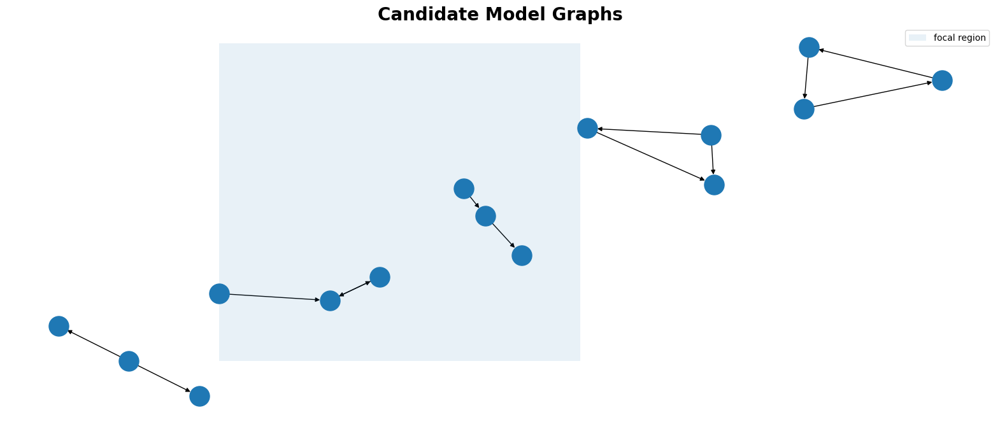

```{=html}
<!-- Compact Hero Section -->
<div class="hero fade-in">
  
  <h1>Hi, I'm Nathaniel 👋</h1>
  <p class="tagline"> Data Science Leadership · Bayesian Statistics & Causal Inference · Still Learning...</p>
  <div class="mt-3">
    <a href="opensource.qmd" class="btn btn-primary btn-lg">View My Work</a>
    <a href="blog.qmd" class="btn btn-outline-light btn-lg">Read My Blog</a>
    <a href="https://bayesian-causal-inference.com/" class="btn btn-outline-light btn-lg" target="_blank" rel="noopener"><i class="bi bi-book"></i> Bayesian Causal Inference</a>
  </div>
</div>
```


```{=html}
<!-- About Me Inline -->
<div class="container my-5 fade-in">
  
  <h2>About Me</h2>
  <p>
    I'm an experienced <b>Data-Scientist</b> and <b>Statistician</b> helping organisations make better decisions through data and experimentation. Using my expertise in <i>Bayesian methods, Causal inference and Probabilistic AI</i> I've learned to drive impact across multiple industries. I share what i've learned here.
  </p>
</div>
```

```{=html}
<!-- Recent Highlights Section -->
<div class="container my-5">
  <h2 class="mb-4 fade-in">Recent Highlights</h2>
  <div class="row">
    <div class="col-md-4 fade-in">
      <div class="card highlight-card">
        <div class="card-body">
          <h5 class="card-title">Football Skills with Wyatt</h5>
          <p class="card-text">A project with my six-year-old son. We fit a four-skill version of the Soccer Factor Model to ten seasons of Europe's top five leagues, to separate a forward's skill from his team's strength. Wyatt can ask the model who's better; grown-ups can check how it works.</p>
          <a href="football_models_with_wyatt/index.qmd" class="btn btn-primary">Explore</a>
          <a href="football_models_with_wyatt/model.qmd" class="btn btn-outline-primary">How it works</a>
        </div>
      </div>
    </div>
    <div class="col-md-4 fade-in">
      <div class="card highlight-card">
        <div class="card-body">
          <h5 class="card-title">Building the Mechanism: Front-Door Identification with Bayesian SEMs</h5>
          <p class="card-text">My talk for the Causal Data Science Meeting 2026. The front-door criterion identifies causal effects despite unmeasured confounding, but only if the mediator carries the whole effect. I argue the mediator should be built, not found, and show how to audit that construction with Bayesian SEMs in PyMC.</p>
          <a href="talks/cdsm_2026_frontdoor/frontdoor_sem.qmd" class="btn btn-primary">View Slides</a>
        </div>
      </div>
    </div>
    <div class="col-md-4 fade-in">
      <div class="card highlight-card">
        <div class="card-body">
          <h5 class="card-title">Podcast Appearance on Learning Bayesian Statistics</h5>
          <p class="card-text">Talking confirmatory factor analysis & Bayesian methods with Alex Andorra on Learning Bayesian Statistics.</p>
          <a href="https://www.youtube.com/watch?v=WEb9SnVLTmE&t=3s" class="btn btn-primary">Listen</a>
        </div>
      </div>
    </div>
  </div>
</div>
```