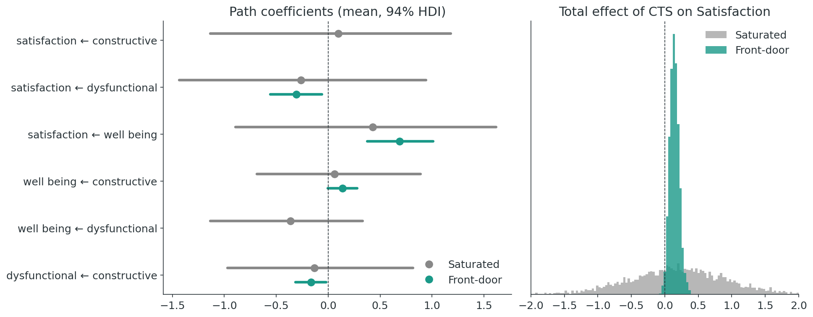
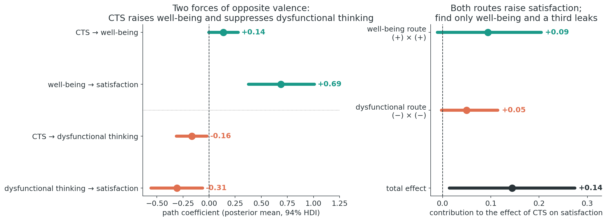
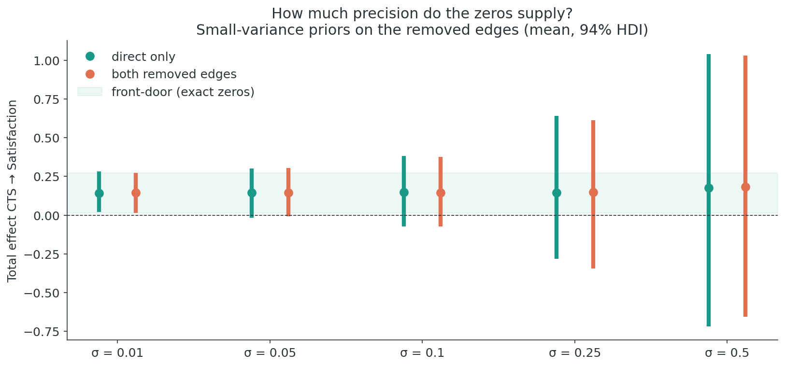
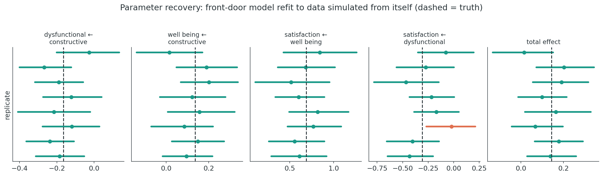
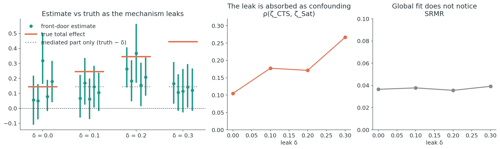
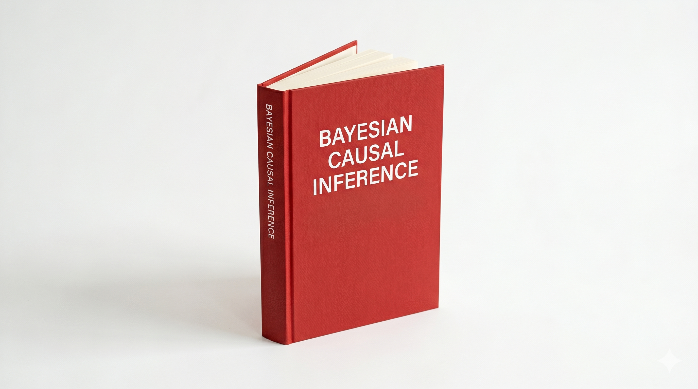

```{python}
#| echo: false
#| output: false
import matplotlib.pyplot as plt
import matplotlib as mpl
from matplotlib.patches import Circle, FancyArrowPatch, FancyBboxPatch
import matplotlib.patheffects as pe

TEAL = "#1a9988"
CORAL = "#e07050"
DARK = "#2a3439"
GREY = "#888888"
BG = "#F5F5F5"
BLUE = "#3B9DDD"

mpl.rcParams.update({
    "figure.facecolor": "white",
    "axes.facecolor": "white",
    "text.color": DARK,
    "font.family": "sans-serif",
    "font.size": 13,
    "figure.dpi": 150,
})


def rounded_box(ax, x, y, w, h, text, fc="white", ec="#BBBBBB",
                fontsize=14, weight="bold", color=DARK):
    patch = FancyBboxPatch(
        (x, y), w, h,
        boxstyle="round,pad=0.02,rounding_size=0.08",
        linewidth=2, edgecolor=ec, facecolor=fc, zorder=2)
    patch.set_path_effects([
        pe.SimplePatchShadow(offset=(2, -2), alpha=0.12), pe.Normal()])
    ax.add_patch(patch)
    ax.text(x + w/2, y + h/2, text, ha="center", va="center",
            fontsize=fontsize, weight=weight, color=color, zorder=3)


def node(ax, xy, label, color="#FFFFFF", edge=DARK, r=0.22, fontsize=12,
         linestyle="-"):
    c = Circle(xy, r, facecolor=color, edgecolor=edge,
               linewidth=2.2, linestyle=linestyle, zorder=3)
    c.set_path_effects([
        pe.SimplePatchShadow(offset=(2, -2), alpha=0.15), pe.Normal()])
    ax.add_patch(c)
    ax.text(*xy, label, ha="center", va="center",
            fontsize=fontsize, weight="bold", color=DARK, zorder=4)


def arrow(ax, p1, p2, color=DARK, rad=0, lw=3, alpha=1, linestyle="-",
          shrink=18, both=False):
    style = "<|-|>,head_width=0.4,head_length=0.6" if both else \
        "Simple,tail_width=0.7,head_width=10,head_length=12"
    arr = FancyArrowPatch(
        p1, p2,
        connectionstyle=f"arc3,rad={rad}",
        arrowstyle=style,
        linewidth=lw if both else lw, color=color, linestyle=linestyle,
        alpha=alpha, shrinkA=shrink, shrinkB=shrink, zorder=1,
        fill=not both)
    ax.add_patch(arr)


def canvas(figsize=(10, 5)):
    fig, ax = plt.subplots(figsize=figsize, facecolor=BG)
    ax.set_facecolor(BG)
    ax.set_xlim(0, 10)
    ax.set_ylim(0, 6)
    ax.axis("off")
    return fig, ax
```

## Preliminaries {.smaller}

:::{.callout-warning}
## Who am I?
- I'm a __data scientist__ at __[PandaDoc]{.blue}__
    - Bayesian statistician,
    - Reformed philosopher and logician.
- Website: [https://nathanielf.github.io/](https://nathanielf.github.io/)
:::

{fig-align="center" width="150px"}

::: {.callout-tip}
## Code or it didn't Happen
The companion notebook, with every model and sensitivity analysis in this talk, is [here](https://github.com/NathanielF/NathanielF.github.io/blob/master/talks/cdsm_2026_frontdoor/notebook/frontdoor_sem_sensitivity.ipynb). The worked example is drawn from the SEM chapter of _Bayesian Causal Inference_ (Vincent & Forde, in preparation).
:::


## The Pitch

The front-door criterion identifies a causal effect **through unmeasured confounding**, with no instrument required.

. . .

So why does almost nobody use it?

- It asks the mediator to carry **everything**: every directed path from $X$ to $Y$.
- Any effect that **leaks** around the mediator breaks identification.
- Read as a demand on a single observed node, almost no real mediator qualifies.

. . .

**The argument:** the mediator should be [__built, not found__]{.blue}. Identification is a piece of information architecture.

::: {.notes}
The pitch in one sentence: front-door is underused because we read it as a search problem, look for the one variable that carries the whole effect. I want to recast it as a design problem. We build a mechanism out of measured constructs, argue it is exhaustive, and the zero restrictions of a structural equation model do the identifying. Fifteen minutes: the criterion and why it fails as a search; the construction on a published job-satisfaction model; then an audit of how much of the result the construction is responsible for.
:::


## Agenda

::: {.fragment .fade-in}
**Act I: The Demand of the Front Door.** Why a single mediator node almost never qualifies, and why identification is an architecture rather than a discovery
:::
::: {.fragment .fade-in}
**Act II: Building the Mechanism.** A bivalent mediator set for job satisfaction, encoded in two matrices of a Bayesian SEM
:::
::: {.fragment .fade-in}
**Act III: Auditing the Architecture.** Relaxing the zeros, recovering the parameters, and springing a leak
:::


# Act I: The Demand of the Front Door {background-color="#2a3439"}


## The Front-Door Criterion {.smaller}

::::{.columns}
:::{.column width="45%"}

Pearl (1995): $M$ identifies the effect of $X$ on $Y$ when

1. $M$ intercepts **every** directed path from $X$ to $Y$
2. There is no unblocked back-door path from $X$ to $M$
3. Every back-door path from $M$ to $Y$ is blocked by $X$

::: {.fragment .fade-in}
Then, despite the unmeasured $U$:

$$P(y \mid do(x)) = \sum_m P(m \mid x) \sum_{x'} P(y \mid m, x') P(x')$$

Two well-identified pieces, $X \to M$ and $M \to Y \mid X$, are chained together.
:::

:::
:::{.column width="55%"}

```{python}
#| echo: false
fig, ax = canvas((8, 4.8))
ax.set_aspect("equal")
node(ax, (1.5, 2.0), "X", r=0.45, fontsize=20)
node(ax, (5.0, 2.0), "M", r=0.45, fontsize=20, color="#E6F4F2", edge=TEAL)
node(ax, (8.5, 2.0), "Y", r=0.45, fontsize=20)
node(ax, (5.0, 4.8), "U", r=0.45, fontsize=20, color=BG, edge=GREY, linestyle="--")
arrow(ax, (1.5, 2.0), (5.0, 2.0), color=TEAL, lw=5, shrink=30)
arrow(ax, (5.0, 2.0), (8.5, 2.0), color=TEAL, lw=5, shrink=30)
arrow(ax, (5.0, 4.8), (1.5, 2.0), color=GREY, lw=3, linestyle="--", shrink=30)
arrow(ax, (5.0, 4.8), (8.5, 2.0), color=GREY, lw=3, linestyle="--", shrink=30)
ax.text(5.0, 0.7, "the mechanism must carry the whole effect",
        ha="center", fontsize=15, color=DARK, style="italic")
plt.show()
```

:::
::::

::: {.notes}
State the criterion quickly; this audience knows it. The point to land is the first condition. M must intercept every directed path. The front-door estimand is the total effect, not a share of it, so the mediator is not "a" mechanism, it has to be "the" mechanism. U can confound X and Y as badly as it likes. What it cannot do is touch the mechanism.
:::


## Why It Is Rarely Used {.smaller}

::::{.columns}
:::{.column width="38%"}

- A bare DAG node is a **single indicator**: loading fixed at 1, no measurement error.
- Asked to exhaust a pathway in social, marketing or organisational data, it fails.

::: {.fragment .fade-in}
- The pieces exist: Pearl admits a **mediator set**; Kuroki (2000) and Kuroki & Cai (2004) treat front-door in linear SEMs; multi-indicator latents are standard practice.

**What is missing is the construction step.**
:::

:::
:::{.column width="62%"}

```{python}
#| echo: false
fig, axs = plt.subplots(1, 2, figsize=(11, 3.9), facecolor=BG)
for ax in axs:
    ax.set_facecolor(BG); ax.set_xlim(0, 10); ax.set_ylim(0, 6); ax.set_aspect("equal"); ax.axis("off")

ax = axs[0]
ax.set_ylim(-0.2, 6.6); ax.set_aspect("equal")
ax.text(5, 6.3, "FOUND", ha="center", fontsize=22, weight="heavy", color="#555555")
ax.text(5, 5.85, "one node, asked to carry everything", ha="center", fontsize=12)
node(ax, (1.3, 2.4), "X", r=0.55, fontsize=18)
node(ax, (5.0, 2.4), "M", r=0.55, fontsize=18)
node(ax, (8.7, 2.4), "Y", r=0.55, fontsize=18)
arrow(ax, (1.3, 2.4), (5.0, 2.4), lw=4, shrink=28)
arrow(ax, (5.0, 2.4), (8.7, 2.4), lw=4, shrink=28)
arrow(ax, (1.3, 2.4), (8.7, 2.4), color=CORAL, lw=3, rad=0.45, linestyle="--", shrink=28)
ax.text(5.0, 0.1, "leak", ha="center", fontsize=14, color=CORAL, weight="bold")

ax = axs[1]
ax.set_ylim(-0.2, 6.6); ax.set_aspect("equal")
ax.text(5, 6.3, "BUILT", ha="center", fontsize=22, weight="heavy", color="#555555")
ax.text(5, 5.85, "constructs designed to exhaust the pathway", ha="center", fontsize=12)
node(ax, (1.2, 2.6), "CTS", r=0.6, fontsize=13)
node(ax, (5.0, 3.8), "WB", r=0.6, fontsize=13, color="#E6F4F2", edge=TEAL)
node(ax, (5.0, 1.4), "DTS", r=0.6, fontsize=13, color="#FBEAE5", edge=CORAL)
node(ax, (8.8, 2.6), "Sat", r=0.6, fontsize=13)
arrow(ax, (1.2, 2.6), (5.0, 3.8), color=TEAL, lw=4, shrink=30)
arrow(ax, (1.2, 2.6), (5.0, 1.4), color=CORAL, lw=4, shrink=30)
arrow(ax, (5.0, 3.8), (8.8, 2.6), color=TEAL, lw=4, shrink=30)
arrow(ax, (5.0, 1.4), (8.8, 2.6), color=CORAL, lw=4, shrink=30)
for (cx, cy, up) in [(5.0, 3.8, True), (5.0, 1.4, False)]:
    by = cy + 0.95 if up else cy - 1.25
    for dx in (-0.55, 0.0, 0.55):
        ax.add_patch(FancyBboxPatch((cx + dx - 0.16, by), 0.32, 0.28,
                                    boxstyle="round,pad=0.02", fc="white", ec="#999999", lw=1.2, zorder=2))
        ax.plot([cx + dx, cx], [by + (0 if up else 0.28), cy + (0.6 if up else -0.6)],
                color="#BBBBBB", lw=1, zorder=1)
ax.text(8.8, 0.6, "three indicators\nper construct", ha="center", fontsize=10, color=GREY)
fig.tight_layout()
plt.show()
```

:::
::::

::: {.notes}
This is the hinge of the talk. On the left, the way we usually read the criterion: go and find a node M. One observed variable, loading fixed at one, no error, and we must believe it carries the whole effect. Any leak, the dashed arc, and identification is gone. Morgan and Winship's complaint applies here: explanations that stop at "X raises Y" without a mechanism aren't good enough, yet the front-door criterion demands a mechanism so complete that no single node can supply it. On the right, the alternative: build the mechanism. A set of latent constructs, each measured by its own indicators, chosen because together they plausibly exhaust the pathway. None of the pieces are new. What is usually left implicit is the construction step itself, and that is what I want to make explicit.
:::


## Identification as Information Architecture {.smaller}

Every credible design decides **where variation is allowed to flow**. None of these plans is found in the data.

| Design | Unwanted variation is... | The argument you owe |
|---|---|---|
| **Propensity score weighting** | *rebalanced*: reweighting builds a pseudo-population where treatment is independent of the observed covariates | every confounder is observed, and overlap holds |
| **Double ML** | *residualised away*: flexible nuisance models partial it out of $T$ and $Y$ | every confounder is observed |
| **Mundlak device** | *absorbed by group means*: cluster means of the covariates soak up the correlation between group effects and treatment | the unobserved confounding lives at the group level |
| **Control-function IV** | *modelled explicitly*: the first-stage residual $\hat v$ enters the outcome equation | relevance and exclusion of the instrument |
| **Front-door SEM** | *quarantined*: confounding may live in $\text{Cov}(\zeta_X, \zeta_Y)$, and **nowhere else** | the mechanism is exhaustive and unconfounded |

. . .

A structural equation model is a blueprint of permitted covariances. The front-door design is one floor plan: **the effect must walk through the mechanism, the confounding must stay in its room.**

::: {.notes}
This is the frame I want you to leave with. These designs are familiar because they are presented as estimators, but each is an architecture: a decision about which variation is nuisance and where it is allowed to go. Read the table top to bottom and the confounding gets harder to see. Propensity weighting rebalances it away, and DML residualises it away, but both need every confounder observed. The Mundlak device tolerates unobserved confounding provided it lives at the group level, where the cluster means can absorb it. The control function gives unobserved confounding a named term, paid for with an instrument. The front-door SEM quarantines it: treatment-outcome confounding is allowed to exist, but only in one covariance cell, and the mechanism is walled off from it. In each case the identifying argument is about the design, not about anything the data can certify.
:::


# Act II: Building the Mechanism {background-color="#2a3439"}


## The Job Satisfaction Constructs {.smaller}

::::{.columns}
:::{.column width="38%"}

Houghton & Jinkerson (2007): 12 indicators, 4 constructs; 263 observations simulated from their published correlations.

- **CTS**, constructive thought strategies (treatment): `EBA`, `ST`, `MI`
- **DTS**, dysfunctional thought: `DA1`–`DA3`
- **WB**, well-being: `UF1`, `UF2`, `FOR`
- **Satisfaction** (outcome): `JW1`–`JW3`

::: {.fragment .fade-in}
The mechanism is **bivalent**: CTS *suppresses* a negative construct and *raises* a positive one.
:::

:::
:::{.column width="62%"}

```{python}
#| echo: false
fig, ax = plt.subplots(figsize=(10, 6.3), facecolor=BG)
ax.set_facecolor(BG); ax.set_xlim(0, 12); ax.set_ylim(0, 7.6); ax.set_aspect("equal"); ax.axis("off")

pos = {"CTS": (1.4, 3.6), "WB": (6.0, 5.1), "DTS": (6.0, 2.1), "Sat": (10.6, 3.6)}
style = {"CTS": ("white", DARK), "WB": ("#E6F4F2", TEAL), "DTS": ("#FBEAE5", CORAL), "Sat": ("white", DARK)}
indicators = {"CTS": ["EBA", "ST", "MI"], "WB": ["UF1", "UF2", "FOR"],
              "DTS": ["DA1", "DA2", "DA3"], "Sat": ["JW1", "JW2", "JW3"]}
R = 0.6
for name, (x, y) in pos.items():
    node(ax, (x, y), name, color=style[name][0], edge=style[name][1], r=R, fontsize=13)
    up = name == "WB"
    for k, ind in enumerate(indicators[name]):
        bx = x - 0.9 + 0.9 * k
        by = y + 1.15 if up else y - 1.5
        ax.add_patch(FancyBboxPatch((bx - 0.36, by), 0.72, 0.32, boxstyle="round,pad=0.02",
                                    fc="white", ec="#999999", lw=1.1, zorder=2))
        ax.text(bx, by + 0.16, ind, ha="center", va="center", fontsize=8, color=DARK, zorder=3)
        ax.plot([bx, x], [by if up else by + 0.32, y + (R if up else -R)],
                color="#BBBBBB", lw=1, zorder=1)

arrow(ax, pos["CTS"], pos["WB"], color=TEAL, lw=4, shrink=32)
arrow(ax, pos["CTS"], pos["DTS"], color=CORAL, lw=4, shrink=32)
arrow(ax, pos["WB"], pos["Sat"], color=TEAL, lw=4, shrink=32)
arrow(ax, pos["DTS"], pos["Sat"], color=CORAL, lw=4, shrink=32)
ax.text(4.0, 3.6, "no direct CTS → Sat", ha="center", va="center", fontsize=10,
        color=GREY, style="italic")

# the two latent covariances the design leaves free
ax.annotate("", xy=(10.6, 4.25), xytext=(1.4, 4.25),
            arrowprops=dict(arrowstyle="<->", color=BLUE, lw=1.8, ls="--",
                            connectionstyle="arc3,rad=-0.6"))
ax.text(6.0, 7.3, "Cov(ζ_CTS, ζ_Sat): the confounding we survive", ha="center", fontsize=10, color=BLUE)
ax.annotate("", xy=(6.25, 4.5), xytext=(6.25, 2.7),
            arrowprops=dict(arrowstyle="<->", color=BLUE, lw=1.8, ls="--",
                            connectionstyle="arc3,rad=-0.45"))
ax.text(7.05, 3.6, "Cov(ζ_DTS, ζ_WB)", ha="left", va="center", fontsize=9, color=BLUE)
plt.show()
```

:::
::::

::: {.fragment .fade-in}
**The front-door claim:** these two routes *exhaust* CTS's influence: a premise to argue, not a finding.
:::

::: {.notes}
The case study is a model from organisational psychology. Constructive thought strategies, things like positive self-talk, mental rehearsal and challenging your own assumptions, and their relation to job satisfaction. The theory is that these strategies work through two channels with opposite valence: they push dysfunctional thinking down, and they push well-being up. The front-door claim is that those two channels exhaust the influence of CTS. I want to be explicit that this is a premise to be argued, from the theory of dispositional attitudes. Nothing on the following slides proves it.
:::


## One Covariance Form, Two Matrices {.smaller}

Both models share the marginal covariance

$$\Sigma_y = \Lambda(I - \color{blue}{B})^{-1}\color{blue}{\Psi_\zeta}(I - \color{blue}{B})^{-\top}\Lambda^\top + \Psi$$

and the mechanism is encoded entirely in $\color{blue}{B}$ and $\color{blue}{\Psi_\zeta}$.

::::{.columns}
:::{.column}

$$\color{blue}{B} = \begin{bmatrix} \overbrace{0}^{Sat} & \overbrace{\beta_{sw}}^{WB} & \overbrace{\beta_{sd}}^{DTS} & \overbrace{\color{red}{0}}^{CTS} \\ 0 & 0 & \color{red}{0} & \beta_{wc} \\ 0 & 0 & 0 & \beta_{dc} \\ 0 & 0 & 0 & 0 \end{bmatrix}$$

Direct edge CTS → Sat and the path DTS → WB are [removed]{style="color: #e07050;"}.

:::
:::{.column}

$$\color{blue}{\Psi_\zeta} = \begin{bmatrix} \psi_{s} & 0 & 0 & \color{blue}{\psi_{sc}} \\ 0 & \psi_{w} & \color{blue}{\psi_{wd}} & 0 \\ 0 & \color{blue}{\psi_{wd}} & \psi_{d} & 0 \\ \color{blue}{\psi_{sc}} & 0 & 0 & \psi_{c} \end{bmatrix}$$

Exactly two covariances stay free: **treatment–outcome confounding** $\psi_{sc}$, and **structure inside the mediator set** $\psi_{wd}$.

:::
::::

. . .

Every other zero is the formal content of *"the mechanism explains everything."*

::: {.notes}
This slide is the construction, written down. The SEM covariance form is the same for both models; what changes is two matrices. In B we delete the direct edge from CTS to satisfaction, and the DTS to WB path. In Psi zeta, the latent disturbance covariance, we allow exactly two non-zero entries. Psi s-c is the confounding between treatment and outcome; the front-door design exists to survive it, so forbidding it would assume away the problem. Psi w-d is structure internal to the mediator set. Every other zero says that nothing outside the mechanism touches it.
:::


## The Mechanism in Code {.smaller}

::::{.columns}
:::{.column width="65%"}

```{.python code-line-numbers="|1-6|8-11|13-16|18-19"}
FRONTDOOR_PATHS = [
    ("dysfunctional", "constructive"),  # CTS -> DTS
    ("well being", "constructive"),     # CTS -> WB
    ("satisfaction", "well being"),     # WB  -> Sat
    ("satisfaction", "dysfunctional"),  # DTS -> Sat
]
FRONTDOOR_COVS = [
    ("satisfaction", "constructive"),   # confounding we survive
    ("well being", "dysfunctional"),    # inside the mechanism
]
with pm.Model(coords=coords) as frontdoor_model:
    Lambda, Psi = measurement_model(sample_df)
    Psi_zeta = make_Psi_zeta(FRONTDOOR_COVS)
    betas = pmd.Normal("mu_betas", 0, 1, dims="frontdoor_paths")
    B = set_edges(pt.zeros((4, 4)), FRONTDOOR_PATHS, betas.values)

    inv = pt.linalg.solve(pt.eye(4) - B, pt.eye(4))
    Sigma_y = Lambda @ inv @ Psi_zeta @ inv.T @ Lambda.T + Psi
    pm.MvNormal("likelihood", mu=0, cov=Sigma_y, observed=observed_data)
```

:::
:::{.column width="35%"}

- The **edge list** is the mechanism.
- The **permitted covariances** are the walls.
- Everything else is a zero we have to defend.
- The total effect is read off $(I - B)^{-1}$.

:::
::::

::: {.notes}
Code or it didn't happen. Two lists carry the entire identifying argument: the edges that are allowed and the latent covariances that are allowed. Everything else in the model is shared with the saturated version: the same measurement model and the same marginal likelihood. The total effect of CTS on satisfaction is one entry of (I minus B) inverse.
:::


## The Payoff {.smaller}

{fig-align="center" width="60%"}

| | Total effect CTS → Sat | 94% HDI | Posterior SD | SRMR |
|---|---|---|---|---|
| **Saturated** | +0.19 | [−1.25, +1.62] | 0.77 | 0.054 |
| **Front-door** | +0.14 | [+0.01, +0.27] | 0.07 | 0.053 |

. . .

The saturated model is **not identified**: its interval is mostly prior. The front-door model is identified, and its interval **just** excludes zero. Global fit is unchanged: the restrictions trade one-for-one for identification, so [**fit cannot test them**]{.blue}.

::: {.notes}
The saturated model fits well but cannot sign the effect: its interval runs from strongly negative to strongly positive. That width isn't a measurement of anything; the structural parameters aren't identified, so it mostly reflects the priors. The front-door model gives roughly the same point estimate with an identified interval, and its lower end sits just above zero, so I'd say "just excludes zero" rather than make much of it. And SRMR is essentially identical. That last fact is the uncomfortable one. The data cannot tell these two models apart. Whatever support the front-door estimate has comes from how well the mechanism was built. So the obvious next question is: how much of this precision is the data, and how much is the zeros?
:::


## What the Second Mediator Buys {.smaller}

{fig-align="center" width="78%"}

::::{.columns}
:::{.column}
- CTS **raises** a positive force (well-being: +0.14 × +0.69 = **+0.09**) and **suppresses** a negative one (dysfunctional thinking: −0.16 × −0.31 = **+0.05**).
- *Find* only well-being: the suppression route becomes a **leak**, and the front door **misses about a third (35%)** of the effect.
:::
:::{.column}
::: {.fragment .fade-in}
Two different gains from building:

- **Several indicators per construct** handle *measurement error*.
- **Several constructs, of opposite valence**, handle *exhaustiveness*: that is what closes the pathway.
:::
:::
::::

::: {.notes}
This is what "built, not found" buys, in numbers, and it's where the bivalence becomes visible. On the left are the four links. Constructive thinking raises well-being, and well-being raises satisfaction: two positives. It also suppresses dysfunctional thinking, which itself drags satisfaction down: two negatives. Both routes therefore raise satisfaction, one by adding a good force, the other by removing a bad one. In a linear SEM the total effect is the sum of the two routes: about 0.09 through well-being and 0.05 through suppression. Neither route on its own has an interval clear of zero; only the two together do. Now suppose we had gone looking for a mediator, found well-being, and stopped. A front door through well-being alone treats the dysfunctional-thinking route as a path around the mediator, a leak, and as we'll see in Act Three, a leak biases the front door by exactly its size. So the single-mediator analysis would report only the well-being route and miss about a third of the effect. Two different things come from building. Multiple indicators per construct deal with measurement error. Multiple constructs, chosen to cover opposite valences, deal with exhaustiveness, which is what the front door actually needs.
:::


# Act III: Auditing the Architecture {background-color="#2a3439"}


## Relaxing the Zeros {.smaller}

::::{.columns}
:::{.column width="65%"}



:::
:::{.column width="35%"}

Muthén & Asparouhov (2012): replace each exact zero with $\text{Normal}(0, \sigma)$ and watch the conclusion.

::: {.fragment .fade-in}
- The **mean barely moves** (≈ 0.14–0.18): the data are nearly silent about the direct edge.
- The **interval does all the moving**: at $\sigma = 0.05$ the HDI already reaches zero; at $\sigma = 0.5$ it is almost as wide as the saturated model's.
- Re-admitting DTS → WB **changes nothing**. One zero, CTS → Sat, carries the precision.
:::

:::
::::

::: {.notes}
This is the precision budget. Muthén and Asparouhov's suggestion is to treat an exact zero as the limit of a small-variance prior, and then watch the conclusion as you loosen it. The point estimate hardly moves, because the data have almost nothing to say about the direct edge. What moves is the interval. A prior of sigma 0.05, which says the direct effect is almost certainly smaller than about a tenth, is already enough for the interval to touch zero. And relaxing the DTS to WB zero as well makes no difference: the identifying work is done by one restriction, the exclusion of the direct path. That is not an embarrassment for the method. It is the honest accounting: the front-door estimate is exactly as credible as the argument that nothing leaks around the mechanism.
:::


## Simulating from the Mechanism {.smaller}
### Can the model recover itself?

::::{.columns}
:::{.column width="45%"}

```{.python code-line-numbers="|1-3|4-5|6-9"}
# Fix every parameter at the fitted values,
# plus a direct leak the front-door model forbids
with pm.do(generator, {**truth, "leak": [delta]}):
    y = pm.sample_prior_predictive(draws=1)[
        "prior"]["likelihood"]  # one synthetic survey, n = 263
# Condition a fresh front-door model on it
with pm.observe(build_frontdoor(observed=None),
                {"likelihood": y}):
    idata = pm.sample()
```

::: {.fragment .fade-in}
With $\delta = 0$ the model **recovers what generated the data**: the total-effect HDI covers the truth in 8 / 8 replicates. But the estimates are noisy at $n = 263$, because the CTS → mediator paths are small.
:::

:::
:::{.column width="55%"}



:::
::::

::: {.notes}
Before asking what happens when the mechanism is wrong, check that the model can recover itself. pm.do fixes every parameter at the fitted posterior means, plus a leak term on the direct edge that we can dial up. sample_prior_predictive then draws a synthetic survey of the same size, and pm.observe conditions a fresh front-door model on it. With the leak at zero, every replicate's interval covers the true total effect. Notice the spread, though: in one unlucky sample the paths from CTS into the mediators nearly vanish and the estimate drops towards zero. Precise relative to the saturated model is not the same as precise.
:::


## Springing a Leak {.smaller}

{fig-align="center" width="100%"}

::: {.fragment .fade-in}
- In a linear SEM a front door recovers only what flows **through** its mediators, so a leak of size $\delta$ biases it by exactly $-\delta$ (dotted line). The simulations track this, noisily: five replicates per $\delta$; coverage of the true effect falls to zero by $\delta = 0.3$.
- The leak is **absorbed as confounding**: $\rho(\zeta_{CTS}, \zeta_{Sat})$ rises from 0.10 to 0.27, and **SRMR never moves**.
:::

::: {.notes}
Now dial the leak up. The analytic answer comes first: in a linear model the front door recovers only what flows through its mediators, so the bias is exactly minus the leak. The dotted line is that prediction, and the simulations follow it, noisily, with only five replicates per setting. Where does the leak go? Into the one covariance the design leaves open, the treatment-outcome confounding term. A path around the mechanism is observationally equivalent to the confounding we built the design to tolerate, so with a positive leak the model reads part of the real effect as confounding and under-reports it. And global fit is flat throughout. Nothing in the data warns you. This is why the argument for exhaustiveness has to be made on the theory, and why the relaxation curve belongs next to the point estimate.
:::


## A Design Pattern for People Analytics {.smaller}

::::{.columns}
:::{.column}

- Satisfaction is a leading indicator of **retention**.
- The question HR teams need answered is causal: do coaching or self-leadership programmes actually move it?
- Who receives an intervention and how satisfied they are is **confounded**, and randomisation is rare.
- But engagement surveys already collect **multi-indicator measures** of the relevant constructs.

:::
:::{.column}

::: {.callout-important}
## The recipe
1. **Build** the mechanism from constructs the survey already measures
2. **Argue** that it exhausts the pathway, and say what would break it
3. **Encode** the argument as zeros in $B$ and $\Psi_\zeta$
4. **Audit** the zeros: relax them, simulate leaks, recover parameters
:::

The same pattern applies wherever no single metric qualifies as a front-door mediator, but a designed construct from several correlated signals may.

:::
::::

::: {.notes}
Job satisfaction is not just a convenient textbook dataset; it is a direct instance of a problem people analytics teams face all the time. Interventions are targeted, so who gets them is confounded with how satisfied they are. Randomisation is rare. But surveys already measure the constructs a mechanism could be built from. So the recipe is: build, argue, encode, audit. The audit step is what keeps this honest. It tells you how much of your answer the argument is carrying.
:::


## Conclusion {.smaller}
### Identification is Built

::::{.columns}
:::{.column}

> "SEM is an inference engine that takes in two inputs, qualitative causal assumptions and empirical data, and derives two logical consequences of these inputs: quantitative causal conclusions and statistical measures of fit for the testable implications of the assumptions... __[Fitting the data does not "prove" the causal assumptions, but it makes them tentatively more plausible.]{.blue}__"

-- Bollen & Pearl, _Eight Myths about Causality and Structural Equation Models_

:::
:::{.column}

::: {.fragment .fade-in}
- The front-door restrictions are not even *tentatively* tested by fit: they are paid for in identification, one-for-one.
:::

::: {.fragment .fade-in}
- So the warrant for the estimate lives in the **construction**: the choice of constructs, their measurement, and the argument that they exhaust the pathway.
:::

::: {.fragment .fade-in}
- Bayesian SEMs make that warrant **auditable**: soften the zeros, simulate the leaks, and report how much of the answer the architecture supplies.
:::

:::
::::

::: {.notes}
Bollen and Pearl's line is the right one for SEM in general: fit makes assumptions tentatively more plausible. The front-door restrictions are a harder case. Because they trade one-for-one with identification, fit is silent about them. So the warrant sits entirely in the construction. That is not a counsel of despair. It means the argument is about design, which we can state, criticise and stress-test, rather than something we hope the data will certify.
:::


## {background-color="black"}

::: {style="color: white; font-size: 1.6em; font-weight: bold; text-align: center; margin-top: 150px;"}
"The mediator is not found.

It is built."
:::


## Resources {.smaller}

:::: {.columns}
::: {.column width="55%"}

:::{.callout-tip}
## Resources
- Companion notebook: [github.com/NathanielF/.../frontdoor_sem_sensitivity.ipynb](https://github.com/NathanielF/NathanielF.github.io/blob/master/talks/cdsm_2026_frontdoor/notebook/frontdoor_sem_sensitivity.ipynb)
- PyMC: [pymc.io](https://www.pymc.io)
- Pearl (1995), "Causal Diagrams for Empirical Research," *Biometrika*
- Kuroki (2000), "Selection of Post-Treatment Variables for Estimating Total Effect," *J. Japan Stat. Soc.*
- Kuroki & Cai (2004), "Selection of Identifiability Criteria for Total Effects," *UAI*
- Muthén & Asparouhov (2012), "Bayesian SEM: A More Flexible Representation of Substantive Theory," *Psych. Methods*
- Houghton & Jinkerson (2007), "Constructive Thought Strategies and Job Satisfaction," *J. Business & Psychology*
- Bollen & Pearl (2013), "Eight Myths about Causality and SEMs"
:::

:::
::: {.column width="45%"}
{width="70%"}
:::
::::
