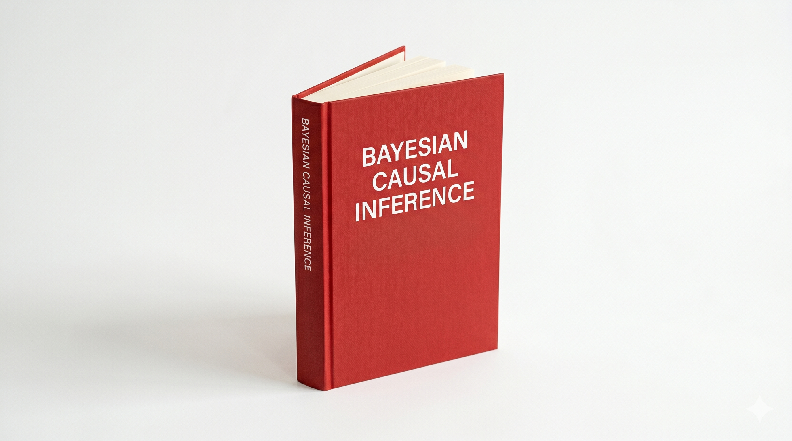
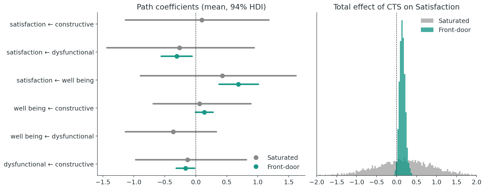
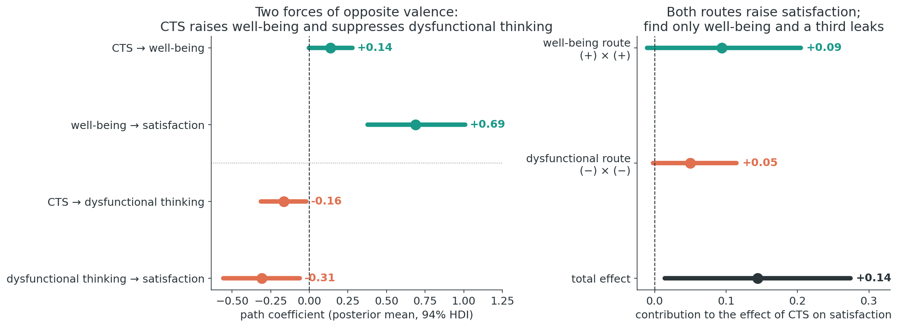
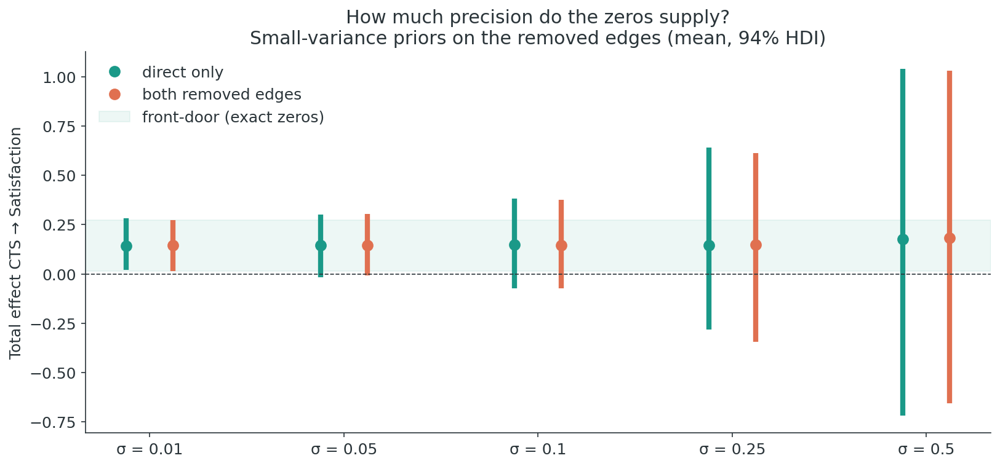
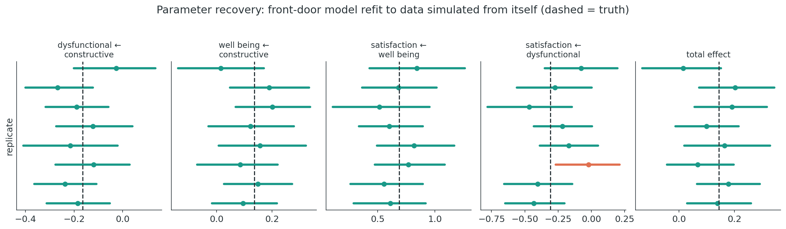
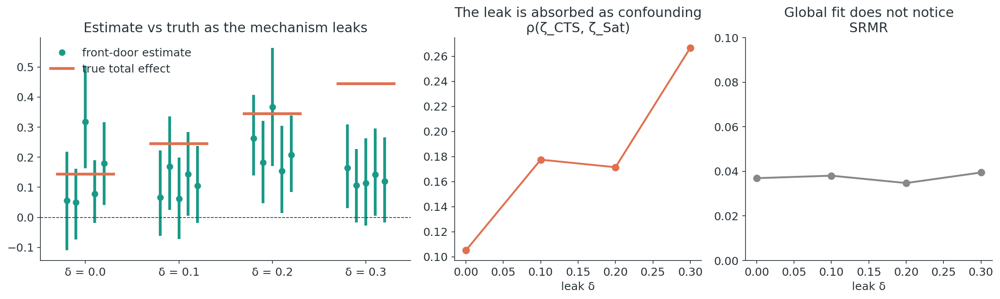

```{python}
#| echo: false
#| output: false
import matplotlib.pyplot as plt
import matplotlib as mpl
from matplotlib.patches import Circle, FancyArrowPatch, FancyBboxPatch
import matplotlib.patheffects as pe

TEAL = "#1a9988"
CORAL = "#e07050"
DARK = "#2a3439"
GREY = "#888888"
BG = "#F5F5F5"
BLUE = "#3B9DDD"

mpl.rcParams.update({
    "figure.facecolor": "white",
    "axes.facecolor": "white",
    "text.color": DARK,
    "font.family": "sans-serif",
    "font.size": 13,
    "figure.dpi": 150,
})


def rounded_box(ax, x, y, w, h, text, fc="white", ec="#BBBBBB",
                fontsize=14, weight="bold", color=DARK):
    patch = FancyBboxPatch(
        (x, y), w, h,
        boxstyle="round,pad=0.02,rounding_size=0.08",
        linewidth=2, edgecolor=ec, facecolor=fc, zorder=2)
    patch.set_path_effects([
        pe.SimplePatchShadow(offset=(2, -2), alpha=0.12), pe.Normal()])
    ax.add_patch(patch)
    ax.text(x + w/2, y + h/2, text, ha="center", va="center",
            fontsize=fontsize, weight=weight, color=color, zorder=3)


def node(ax, xy, label, color="#FFFFFF", edge=DARK, r=0.22, fontsize=12,
         linestyle="-"):
    c = Circle(xy, r, facecolor=color, edgecolor=edge,
               linewidth=2.2, linestyle=linestyle, zorder=3)
    c.set_path_effects([
        pe.SimplePatchShadow(offset=(2, -2), alpha=0.15), pe.Normal()])
    ax.add_patch(c)
    ax.text(*xy, label, ha="center", va="center",
            fontsize=fontsize, weight="bold", color=DARK, zorder=4)


def arrow(ax, p1, p2, color=DARK, rad=0, lw=3, alpha=1, linestyle="-",
          shrink=18, both=False):
    style = "<|-|>,head_width=0.4,head_length=0.6" if both else \
        "Simple,tail_width=0.7,head_width=10,head_length=12"
    arr = FancyArrowPatch(
        p1, p2,
        connectionstyle=f"arc3,rad={rad}",
        arrowstyle=style,
        linewidth=lw if both else lw, color=color, linestyle=linestyle,
        alpha=alpha, shrinkA=shrink, shrinkB=shrink, zorder=1,
        fill=not both)
    ax.add_patch(arr)


def canvas(figsize=(10, 5)):
    fig, ax = plt.subplots(figsize=figsize, facecolor=BG)
    ax.set_facecolor(BG)
    ax.set_xlim(0, 10)
    ax.set_ylim(0, 6)
    ax.axis("off")
    return fig, ax
```

## Preliminaries {.smaller}

:::: {.columns}
::: {.column width="40%"}
:::{.callout-warning}
## Who am I?
- I'm a __data scientist__ at __[PandaDoc]{.blue}__
    - Bayesian statistician,
    - Reformed philosopher and logician.
- Website: [https://nathanielf.github.io/](https://nathanielf.github.io/)
:::

::: {.callout-tip}
## Code or It Didn't Happen
The companion notebook, with every model and sensitivity analysis in this talk, is [here](https://github.com/NathanielF/NathanielF.github.io/blob/master/talks/cdsm_2026_frontdoor/notebook/frontdoor_sem_sensitivity.ipynb). The worked example is drawn from the SEM chapter of [_Bayesian Causal Inference_ (Vincent & Forde, in preparation).](https://bayesian-causal-inference.com/)
:::

:::

::: {.column width="60%"}

{width="70%"}

- Mailing list is available on the website. 
- Confirm email to be notified as we release chapters online. 
:::

::::


## The Pitch

The front-door criterion identifies a causal effect **through unmeasured confounding**, with no instrument required.

. . .

So why does almost nobody use it?

- It asks the mediator to carry **everything**: every directed path from $X$ to $Y$.
- Any effect that **leaks** around the mediator breaks identification.
- Read as a demand on a single observed node, the criterion almost never holds.

. . .

**The argument:** the mediator should be [__built, not found__]{.blue}. Identification is architecture.


## Agenda

::: {.fragment .fade-in}
**Act I: The Demand of the Front Door.** Why a single mediator node almost never qualifies, and why identification is an architecture rather than a discovery
:::
::: {.fragment .fade-in}
**Act II: Building the Mechanism.** A bivalent mediator set for job satisfaction, encoded in two matrices of a Bayesian SEM
:::
::: {.fragment .fade-in}
**Act III: Auditing the Architecture.** Relaxing the zeros, recovering the parameters, and springing a leak
:::
::: {.fragment .fade-in}
**Coda: A Design Pattern for People Analytics.** The study the recipe asks for
:::


# Act I: The Demand of the Front Door {background-color="#2a3439"}


## The Front-Door Criterion {.smaller}

::::{.columns}
:::{.column width="45%"}

Pearl (1995): $M$ identifies the effect of $X$ on $Y$ when

1. $M$ intercepts **every** directed path from $X$ to $Y$
2. There is no unblocked back-door path from $X$ to $M$
3. Every back-door path from $M$ to $Y$ is blocked by $X$

::: {.fragment .fade-in}
Then, despite the unmeasured $U$:

$$P(y \mid do(x)) = \sum_m P(m \mid x) \sum_{x'} P(y \mid m, x') P(x')$$

Two well-identified pieces, $X \to M$ and $M \to Y \mid X$, are chained together.
:::

:::
:::{.column width="55%"}

```{python}
#| echo: false
fig, ax = canvas((8, 4.8))
ax.set_aspect("equal")
node(ax, (1.5, 2.0), "X", r=0.45, fontsize=20)
node(ax, (5.0, 2.0), "M", r=0.45, fontsize=20, color="#E6F4F2", edge=TEAL)
node(ax, (8.5, 2.0), "Y", r=0.45, fontsize=20)
node(ax, (5.0, 4.8), "U", r=0.45, fontsize=20, color=BG, edge=GREY, linestyle="--")
arrow(ax, (1.5, 2.0), (5.0, 2.0), color=TEAL, lw=5, shrink=30)
arrow(ax, (5.0, 2.0), (8.5, 2.0), color=TEAL, lw=5, shrink=30)
arrow(ax, (5.0, 4.8), (1.5, 2.0), color=GREY, lw=3, linestyle="--", shrink=30)
arrow(ax, (5.0, 4.8), (8.5, 2.0), color=GREY, lw=3, linestyle="--", shrink=30)
ax.text(5.0, 0.7, "the mechanism must carry the whole effect",
        ha="center", fontsize=15, color=DARK, style="italic")
plt.show()
```

:::
::::

## Why It Is Rarely Used {.smaller}

::::{.columns}
:::{.column width="38%"}

- A bare DAG node is a **single indicator**: loading fixed at 1, no measurement error, so a noisy proxy lets part of the effect slip past it.
- Asked to exhaust a pathway in social, marketing or organisational data, it usually fails.

::: {.fragment .fade-in}
- The pieces exist: Pearl allows a **mediator set**; Kuroki (2000) and Kuroki & Cai (2004) treat front-door in linear SEMs; multi-indicator latents are standard practice.

**What is missing is the construction step.**
:::

:::
:::{.column width="62%"}

```{python}
#| echo: false
fig, axs = plt.subplots(1, 2, figsize=(11, 3.9), facecolor=BG)
for ax in axs:
    ax.set_facecolor(BG); ax.set_xlim(0, 10); ax.set_ylim(0, 6); ax.set_aspect("equal"); ax.axis("off")

ax = axs[0]
ax.set_ylim(-0.2, 6.6); ax.set_aspect("equal")
ax.text(5, 6.3, "FOUND", ha="center", fontsize=22, weight="heavy", color="#555555")
ax.text(5, 5.85, "one node, asked to carry everything", ha="center", fontsize=12)
node(ax, (1.3, 2.4), "X", r=0.55, fontsize=18)
node(ax, (5.0, 2.4), "M", r=0.55, fontsize=18)
node(ax, (8.7, 2.4), "Y", r=0.55, fontsize=18)
arrow(ax, (1.3, 2.4), (5.0, 2.4), lw=4, shrink=28)
arrow(ax, (5.0, 2.4), (8.7, 2.4), lw=4, shrink=28)
arrow(ax, (1.3, 2.4), (8.7, 2.4), color=CORAL, lw=3, rad=0.45, linestyle="--", shrink=28)
ax.text(5.0, 0.1, "leak", ha="center", fontsize=14, color=CORAL, weight="bold")

ax = axs[1]
ax.set_ylim(-0.2, 6.6); ax.set_aspect("equal")
ax.text(5, 6.3, "BUILT", ha="center", fontsize=22, weight="heavy", color="#555555")
ax.text(5, 5.85, "constructs designed to exhaust the pathway", ha="center", fontsize=12)
node(ax, (1.2, 2.6), "X", r=0.6, fontsize=16)
node(ax, (5.0, 3.8), "M₊", r=0.6, fontsize=16, color="#E6F4F2", edge=TEAL)
node(ax, (5.0, 1.4), "M₋", r=0.6, fontsize=16, color="#FBEAE5", edge=CORAL)
node(ax, (8.8, 2.6), "Y", r=0.6, fontsize=16)
arrow(ax, (1.2, 2.6), (5.0, 3.8), color=TEAL, lw=4, shrink=30)
arrow(ax, (1.2, 2.6), (5.0, 1.4), color=CORAL, lw=4, shrink=30)
arrow(ax, (5.0, 3.8), (8.8, 2.6), color=TEAL, lw=4, shrink=30)
arrow(ax, (5.0, 1.4), (8.8, 2.6), color=CORAL, lw=4, shrink=30)
for (cx, cy, up) in [(5.0, 3.8, True), (5.0, 1.4, False)]:
    by = cy + 0.95 if up else cy - 1.25
    for dx in (-0.55, 0.0, 0.55):
        ax.add_patch(FancyBboxPatch((cx + dx - 0.16, by), 0.32, 0.28,
                                    boxstyle="round,pad=0.02", fc="white", ec="#999999", lw=1.2, zorder=2))
        ax.plot([cx + dx, cx], [by + (0 if up else 0.28), cy + (0.6 if up else -0.6)],
                color="#BBBBBB", lw=1, zorder=1)
ax.text(8.8, 0.6, "three indicators\nper construct", ha="center", fontsize=10, color=GREY)
fig.tight_layout()
plt.show()
```

:::
::::


## Identification as Information Architecture {.smaller}

Every credible design decides **where variation is allowed to flow**. None of these plans is found in the data.

| Design | Unwanted variation is... | The argument you owe |
|---|---|---|
| **Propensity score weighting** | *rebalanced*: reweighting builds a pseudo-population where treatment is independent of the observed covariates | every confounder is observed, and overlap holds |
| **Double ML** | *residualised away*: flexible nuisance models partial it out of $T$ and $Y$ | every confounder is observed |
| **Mundlak device** | *absorbed by group means*: cluster means of the covariates soak up the correlation between group effects and treatment | the unobserved confounding lives at the group level |
| **Control-function IV** | *modelled explicitly*: the first-stage residual $\hat v$ enters the outcome equation | relevance and exclusion of the instrument |
| **Front-door SEM** | *confined*: confounding may live in $\text{Cov}(\zeta_X, \zeta_Y)$, and **nowhere else** | the mechanism is exhaustive and unconfounded |

. . .

A structural equation model is a blueprint of permitted covariances. The front-door design is a floor plan: **the effect must walk through the mechanism, the confounding must be boxed in.**


# Act II: Building the Mechanism {background-color="#2a3439"}


## The Job Satisfaction Constructs {.smaller}

::::{.columns}
:::{.column width="38%"}

Houghton & Jinkerson (2007): 12 indicators, 4 constructs; 263 observations simulated from their published correlations.

- **CTS**, constructive thought strategies (treatment): `EBA`, `ST`, `MI`
- **DTS**, dysfunctional thinking: `DA1`–`DA3`
- **WB**, well-being: `UF1`, `UF2`, `FOR`
- **Satisfaction** (outcome): `JW1`–`JW3`

::: {.fragment .fade-in}
The mechanism is **bivalent**: CTS *suppresses* dysfunctional thinking and *raises* well-being.
:::

:::
:::{.column width="62%"}

```{python}
#| echo: false
fig, ax = plt.subplots(figsize=(10, 6.3), facecolor=BG)
ax.set_facecolor(BG); ax.set_xlim(0, 12); ax.set_ylim(0, 7.6); ax.set_aspect("equal"); ax.axis("off")

pos = {"CTS": (1.4, 3.6), "WB": (6.0, 5.1), "DTS": (6.0, 2.1), "Sat": (10.6, 3.6)}
style = {"CTS": ("white", DARK), "WB": ("#E6F4F2", TEAL), "DTS": ("#FBEAE5", CORAL), "Sat": ("white", DARK)}
indicators = {"CTS": ["EBA", "ST", "MI"], "WB": ["UF1", "UF2", "FOR"],
              "DTS": ["DA1", "DA2", "DA3"], "Sat": ["JW1", "JW2", "JW3"]}
R = 0.6
for name, (x, y) in pos.items():
    node(ax, (x, y), name, color=style[name][0], edge=style[name][1], r=R, fontsize=13)
    up = name == "WB"
    for k, ind in enumerate(indicators[name]):
        bx = x - 0.9 + 0.9 * k
        by = y + 1.15 if up else y - 1.5
        ax.add_patch(FancyBboxPatch((bx - 0.36, by), 0.72, 0.32, boxstyle="round,pad=0.02",
                                    fc="white", ec="#999999", lw=1.1, zorder=2))
        ax.text(bx, by + 0.16, ind, ha="center", va="center", fontsize=8, color=DARK, zorder=3)
        ax.plot([bx, x], [by if up else by + 0.32, y + (R if up else -R)],
                color="#BBBBBB", lw=1, zorder=1)

arrow(ax, pos["CTS"], pos["WB"], color=TEAL, lw=4, shrink=32)
arrow(ax, pos["CTS"], pos["DTS"], color=CORAL, lw=4, shrink=32)
arrow(ax, pos["WB"], pos["Sat"], color=TEAL, lw=4, shrink=32)
arrow(ax, pos["DTS"], pos["Sat"], color=CORAL, lw=4, shrink=32)
ax.text(4.0, 3.6, "no direct CTS → Sat", ha="center", va="center", fontsize=10,
        color=GREY, style="italic")

# the two latent covariances the design leaves free
ax.annotate("", xy=(10.6, 4.25), xytext=(1.4, 4.25),
            arrowprops=dict(arrowstyle="<->", color=BLUE, lw=1.8, ls="--",
                            connectionstyle="arc3,rad=-0.6"))
ax.text(6.0, 7.3, "Cov(ζ_CTS, ζ_Sat): the confounding we survive", ha="center", fontsize=10, color=BLUE)
ax.annotate("", xy=(6.25, 4.5), xytext=(6.25, 2.7),
            arrowprops=dict(arrowstyle="<->", color=BLUE, lw=1.8, ls="--",
                            connectionstyle="arc3,rad=-0.45"))
ax.text(7.05, 3.6, "Cov(ζ_DTS, ζ_WB)", ha="left", va="center", fontsize=9, color=BLUE)
plt.show()
```

:::
::::

::: {.fragment .fade-in}
**The front-door claim:** these two routes *exhaust* CTS's influence. This is the argument to be made. 
:::


## Two Candidate Models {.smaller}
### Same constructs, same data, different assumptions

::::{.columns}
:::{.column width="40%"}

```{python}
#| echo: false
# CANDIDATE DAGS
fig, axs = plt.subplots(1, 2, figsize=(12, 4.4), facecolor=BG)
pos = {"CTS": (1.2, 2.8), "WB": (5.0, 4.4), "DTS": (5.0, 1.2), "Sat": (8.8, 2.8)}
style = {"CTS": ("white", DARK), "WB": ("#E6F4F2", TEAL), "DTS": ("#FBEAE5", CORAL), "Sat": ("white", DARK)}
titles = [("SATURATED", "every theoretically motivated edge"),
          ("FRONT-DOOR", "CTS → {WB, DTS} → Sat, and nothing else")]
for ax, (title, sub) in zip(axs, titles):
    ax.set_facecolor(BG); ax.set_xlim(0, 10); ax.set_ylim(-0.6, 7.6); ax.set_aspect("equal"); ax.axis("off")
    ax.text(5, 7.25, title, ha="center", fontsize=20, weight="heavy", color="#555555")
    ax.text(5, 6.75, sub, ha="center", fontsize=12)
    for k, (x, y) in pos.items():
        node(ax, (x, y), k, color=style[k][0], edge=style[k][1], r=0.6, fontsize=13)
    arrow(ax, pos["CTS"], pos["WB"], color=TEAL, lw=3.5, shrink=30)
    arrow(ax, pos["CTS"], pos["DTS"], color=CORAL, lw=3.5, shrink=30)
    arrow(ax, pos["WB"], pos["Sat"], color=TEAL, lw=3.5, shrink=30)
    arrow(ax, pos["DTS"], pos["Sat"], color=CORAL, lw=3.5, shrink=30)

ax = axs[0]
arrow(ax, pos["CTS"], pos["Sat"], lw=3.5, shrink=30)
arrow(ax, pos["DTS"], pos["WB"], lw=3.5, shrink=30)
ax.text(5, -0.4, "all six disturbance covariances free", ha="center", fontsize=12, color=BLUE)

ax = axs[1]
arrow(ax, pos["CTS"], pos["Sat"], color=CORAL, lw=2, alpha=0.35, linestyle="--", shrink=30)
arrow(ax, pos["DTS"], pos["WB"], color=CORAL, lw=2, alpha=0.35, linestyle="--", shrink=30)
ax.text(3.1, 2.45, "removed", ha="center", fontsize=10, color=CORAL, style="italic")
ax.annotate("", xy=(8.8, 3.45), xytext=(1.2, 3.45),
            arrowprops=dict(arrowstyle="<->", color=BLUE, lw=1.8, ls="--", connectionstyle="arc3,rad=-0.55"))
ax.annotate("", xy=(5.45, 3.9), xytext=(5.45, 1.7),
            arrowprops=dict(arrowstyle="<->", color=BLUE, lw=1.8, ls="--", connectionstyle="arc3,rad=0.45"))
ax.text(5, -0.4, "two covariances free: confounding, and inside the mechanism",
        ha="center", fontsize=12, color=BLUE)
fig.tight_layout()
plt.show()
```

:::

::: {.column width="60%"}
- **Saturated:** assumes nothing about the mechanism. A direct edge, a DTS → WB edge, and every disturbance covariance are left free.
- **Front-door:** deletes CTS → Sat, trades DTS → WB for a free covariance, and leaves only the treatment–outcome confounding open outside the mechanism.
:::
Both fit the same data. **Everything that separates them is an argument for the deletions.**
::::


::: {.notes}
Before any matrices, the two models we'll compare. Both use the same four constructs and the same twelve indicators. The saturated model draws every edge the theory motivates, including a direct path from constructive thinking to satisfaction, and leaves every disturbance covariance free: it assumes nothing about the mechanism. The front-door model makes three moves. It deletes the direct edge. It drops the DTS to WB edge, keeping a free covariance between them instead, so the two poles can still be related without our committing to a direction. And it closes every other disturbance covariance except one: the confounding between treatment and outcome, which the front door is built to survive. Nothing in the data chooses between these pictures. What chooses is whether we can defend the deletions, and that's the next slide.
:::


## Arguing Exhaustiveness {.smaller}
### Two poles absorb both valences

::::{.columns}
:::{.column width="50%"}

**The effect.** Whatever CTS does to satisfaction arrives with a sign: a *lift* (more well-being) or *relief* (less dysfunctional thinking). A positive and a negative pole are **absorbing**: influence of either valence must pass through one of them, so [**no third route is left**]{.blue}.

**Two premises left, one for each deletion:**

- affect is CTS's only channel to satisfaction → no direct edge CTS → Sat
- uptake of CTS isn't driven by temperament → no common cause of CTS and the poles

:::

:::{.column width="50%"}

:::{.fragment .fade-in}
**The confounding.** Unmeasured causes sort the same way, by **what they act on**:

| Unmeasured cause | Acts on | In the front-door model |
|---|---|---|
| **Workplace-specific**: manager, job quality, coaching culture | CTS *and* satisfaction | the one covariance left open: the confounding the design survives |
| **General disposition**: temperament, trait affect | the two poles → satisfaction | absorbed: whatever its sign, it reaches a job-specific outcome only through affect |

:::

:::
::::


::: {.notes}
This is where the warrant for the estimate actually sits, so I want it on screen rather than in a backup. Start with the effect. Think of the two poles as absorbing states. Whatever constructive thinking does to satisfaction, it has to arrive with a sign: either it lifts you, more well-being, or it relieves you, less dysfunctional thinking. A positive pole and a negative pole between them absorb both valences of influence, so there is no third channel for an effect to slip through. That is a much stronger claim than "we found two mediators", and it is one you can argue about. The confounding sorts the same way. Workplace-specific factors, a good manager, a coaching culture, plausibly shape both how someone thinks at work and how satisfied they are with this job. That is the one covariance the design leaves free. General dispositions plausibly reach a domain-specific outcome like job satisfaction only through general affect, so the poles absorb them too. What remains is two premises, and each one licenses a different deletion from the saturated model. First, affect is the only channel from constructive thinking to satisfaction. Absorption catches every affective influence, but it can't catch a route that never touches affect, like performance and rewards. That premise licenses deleting the direct edge. Second, uptake of constructive thinking isn't driven by temperament. Calling it a learnt strategy is the intuition, but what we need is narrower: nothing causes both CTS and the poles. If temperament drove uptake, a disposition would open a back door from CTS into the mechanism. That premise licenses closing the covariances between CTS and the poles. The next slide writes both deletions down as zeros.
:::


## One Covariance Form, Two Matrices {.smaller}

Both candidate models share the marginal covariance

$$\Sigma_y = \Lambda(I - \color{blue}{B})^{-1}\color{blue}{\Psi_\zeta}(I - \color{blue}{B})^{-\top}\Lambda^\top + \Psi$$

and the mechanism is encoded entirely in $\color{blue}{B}$ and $\color{blue}{\Psi_\zeta}$.

::::{.columns}
:::{.column}

$$\color{blue}{B} = \begin{bmatrix} \overbrace{0}^{Sat} & \overbrace{\beta_{sw}}^{WB} & \overbrace{\beta_{sd}}^{DTS} & \overbrace{\color{red}{0}}^{CTS} \\ 0 & 0 & \color{red}{0} & \beta_{wc} \\ 0 & 0 & 0 & \beta_{dc} \\ 0 & 0 & 0 & 0 \end{bmatrix}$$

The edges CTS → Sat and DTS → WB are [removed]{style="color: #e07050;"}.

:::
:::{.column}

$$\color{blue}{\Psi_\zeta} = \begin{bmatrix} \psi_{s} & 0 & 0 & \color{blue}{\psi_{sc}} \\ 0 & \psi_{w} & \color{blue}{\psi_{wd}} & 0 \\ 0 & \color{blue}{\psi_{wd}} & \psi_{d} & 0 \\ \color{blue}{\psi_{sc}} & 0 & 0 & \psi_{c} \end{bmatrix}$$

Exactly two covariances stay free: **treatment–outcome confounding** $\psi_{sc}$, and **structure inside the mediator set** $\psi_{wd}$.

:::
::::

. . .

The two premises are now zeros: *affect is the only channel* is the [red zero]{style="color: #e07050;"} on CTS → Sat in $B$; *uptake isn't temperamental* is the zeros between CTS and the poles in $\Psi_\zeta$. Every other zero is the formal content of *"the mechanism carries the whole effect."*

::: {.notes}
This slide is the construction, written down. The SEM covariance form is the same for the saturated and front-door models; what changes is two matrices. In B we delete the direct edge from CTS to satisfaction, and the DTS to WB path. In Psi zeta, the latent disturbance covariance, we allow exactly two non-zero entries. Psi s-c is the confounding between treatment and outcome; the front-door design exists to survive it, so forbidding it would assume away the problem. Psi w-d is structure internal to the mediator set. Now the two premises from the last slide have an address. Affect being the only channel is the zero in the top-right of B. Uptake not being driven by temperament is the zeros between CTS and the two poles in the last row of Psi zeta. Every other zero says that nothing outside the mechanism touches it.
:::


## The Mechanism in Code {.smaller}

::::{.columns}
:::{.column width="65%"}

```{.python code-line-numbers="|1-6|7-10|11-15|17-19"}
FRONTDOOR_PATHS = [
    ("dysfunctional", "constructive"),  # CTS -> DTS
    ("well being", "constructive"),     # CTS -> WB
    ("satisfaction", "well being"),     # WB  -> Sat
    ("satisfaction", "dysfunctional"),  # DTS -> Sat
]
FRONTDOOR_COVS = [
    ("satisfaction", "constructive"),   # confounding we survive
    ("well being", "dysfunctional"),    # inside the mechanism
]
with pm.Model(coords=coords) as frontdoor_model:
    Lambda, Psi = measurement_model(sample_df)
    Psi_zeta = make_Psi_zeta(FRONTDOOR_COVS)
    betas = pmd.Normal("mu_betas", 0, 1, dims="frontdoor_paths")
    B = set_edges(pt.zeros((4, 4)), FRONTDOOR_PATHS, betas.values)

    inv = pt.linalg.solve(pt.eye(4) - B, pt.eye(4))
    Sigma_y = Lambda @ inv @ Psi_zeta @ inv.T @ Lambda.T + Psi
    pm.MvNormal("likelihood", mu=0, cov=Sigma_y, observed=observed_data)
```

:::
:::{.column width="35%"}

- The **edge list** is the mechanism.
- The **permitted covariances** are the only doors.
- Every other zero is a wall we have to defend.
- The total effect is read off $(I - B)^{-1}$.

:::
::::

::: {.notes}
Code or it didn't happen. Two lists carry the entire identifying argument: the edges that are allowed and the latent covariances that are allowed. Everything else in the model is shared with the saturated version: the same measurement model and the same marginal likelihood. The total effect of CTS on satisfaction is one entry of (I minus B) inverse.
:::


## The Payoff {.smaller}

{fig-align="center" width="60%"}

| | Total effect CTS → Sat | 94% HDI | Posterior SD | SRMR |
|---|---|---|---|---|
| **Saturated** | +0.19 | [−1.25, +1.62] | 0.77 | 0.054 |
| **Front-door** | +0.14 | [+0.01, +0.27] | 0.07 | 0.053 |

. . .

The saturated model is **not identified**: its interval is mostly prior. The front-door model is identified, and its interval **just** excludes zero. Global fit is unchanged: the zeros are spent entirely on identification and leave nothing over, so [**fit cannot test them**]{.blue}.

::: {.notes}
The saturated model fits well but cannot sign the effect: its interval runs from strongly negative to strongly positive. That width isn't a measurement of anything; the structural parameters aren't identified, so it mostly reflects the priors. The front-door model gives roughly the same point estimate with an identified interval, and its lower end sits just above zero, so I'd say "just excludes zero" rather than make much of it. And SRMR is essentially identical. That last fact is the uncomfortable one. The data cannot tell these two models apart. Whatever support the front-door estimate has comes from how well the mechanism was built. So the obvious next question is: how much of this precision is the data, and how much is the zeros?
:::


## What the Second Pole Buys {.smaller}

{fig-align="center" width="78%"}

::::{.columns}
:::{.column}
- CTS **raises** a positive force (well-being: +0.14 × +0.69 ≈ **+0.09**) and **suppresses** a negative one (dysfunctional thinking: −0.16 × −0.31 ≈ **+0.05**).
- Had we found only well-being, the suppression route would become a **leak**, and the front door would **miss about a third** of the effect.
:::
:::{.column}
::: {.fragment .fade-in}
Two gains from building:

- **Several indicators per construct** handle *measurement error*.
- **Opposite poles** handle *exhaustiveness*: drop one, and its valence of influence becomes a leak.
:::
:::
::::

::: {.notes}
This is the absorption argument from a few slides back, in numbers: what "built, not found" buys. On the left are the four links. Constructive thinking raises well-being, and well-being raises satisfaction: two positives. It also suppresses dysfunctional thinking, which itself drags satisfaction down: two negatives. Both routes therefore raise satisfaction, one by adding a good force, the other by removing a bad one. In a linear SEM the total effect is the sum of the two routes: about 0.09 through well-being and 0.05 through suppression. Neither route on its own has an interval clear of zero; only the two together do. Now suppose we had gone looking for a mediator, found well-being, and stopped. A front door through well-being alone treats the dysfunctional-thinking route as a path around the mediator, a leak, and as we'll see in Act Three, a leak biases the front door by exactly its size. So the single-mediator analysis would report only the well-being route and miss about a third of the effect. Two different things come from building. Multiple indicators per construct deal with measurement error. Opposite poles deal with exhaustiveness, which is what the front door actually needs. Drop either pole and the influence of that valence has nowhere to land except a path around the mechanism, which is a leak. That is the third of the effect we would have missed.
:::


# Act III: Auditing the Architecture {background-color="#2a3439"}


## Relaxing the Zeros {.smaller}

::::{.columns}
:::{.column width="65%"}



:::
:::{.column width="35%"}

Muthén & Asparouhov (2012): replace each exact zero with $\text{Normal}(0, \sigma)$ and watch the conclusion.

::: {.fragment .fade-in}
- The **mean barely moves** (≈ 0.14–0.18): the data are nearly silent about the direct edge.
- The **interval does all the moving**: at $\sigma = 0.05$ the HDI already reaches zero; at $\sigma = 0.5$ it is almost as wide as the saturated model's.
- Re-admitting DTS → WB **changes nothing**. One zero, CTS → Sat, carries the precision.
:::

:::
::::

::: {.fragment .fade-in}
**Sensitivity Analysis is vital to all causal inference architectures:** the estimate is exactly as credible as the argument that nothing leaks around the mechanism.
:::


## Simulating from the Mechanism {.smaller}
### Does the model recover the truth it generated?

::::{.columns}
:::{.column width="45%"}

```{.python code-line-numbers="|1-3|4-5|6-9"}
# Fix every parameter at the fitted values,
# plus a direct leak the front-door model forbids
with pm.do(generator, {**truth, "leak": [delta]}):
    y = pm.sample_prior_predictive(draws=1)[
        "prior"]["likelihood"]  # one synthetic survey, n = 263
# Condition a fresh front-door model on it
with pm.observe(build_frontdoor(observed=None),
                {"likelihood": y}):
    idata = pm.sample()
```

::: {.fragment .fade-in}
With $\delta = 0$ the model **recovers what generated the data**: the total-effect HDI covers the truth in 8 / 8 replicates. But the estimates are noisy at $n = 263$, because the CTS → mediator paths are small.
:::

:::
:::{.column width="55%"}



:::
::::


## Springing a Leak {.smaller}

{fig-align="center" width="100%"}

::: {.fragment .fade-in}
- In a linear SEM a front door recovers only what flows **through** its mediators, so a leak of size $\delta$ biases it by exactly $-\delta$ (dotted line).
- The simulations track this, noisily, with five replicates per $\delta$. Coverage of the true effect falls to zero by $\delta = 0.3$.
- The leak is **absorbed as confounding**: $\rho(\zeta_{CTS}, \zeta_{Sat})$ rises from 0.10 to 0.27, and **SRMR never moves**.
- Read with Fulcher et al. (2020), a leaky front door still estimates the **mediated** effect. What it gets wrong is the total.
:::

## Coda: A Design Pattern for People Analytics {.smaller}
### Same logic, easier premises to defend

::::{.columns}
:::{.column width="52%"}

```{python}
#| echo: false
fig, ax = plt.subplots(figsize=(8.4, 6.0), facecolor=BG)
ax.set_facecolor(BG); ax.set_xlim(0, 10); ax.set_ylim(-0.6, 6.6); ax.set_aspect("equal"); ax.axis("off")

pos = {"Course": (1.1, 3.0), "CTS": (3.6, 3.9), "WB": (6.2, 4.9), "DTS": (6.2, 2.9),
       "Support": (4.9, 1.0), "Sat": (8.9, 3.0)}
labels = {"Course": "course", "CTS": "ΔCTS", "WB": "WB", "DTS": "DTS", "Support": "support", "Sat": "Sat"}
styles = {"Course": ("white", DARK), "CTS": ("white", DARK), "WB": ("#E6F4F2", TEAL),
          "DTS": ("#FBEAE5", CORAL), "Support": ("#EAF2FB", BLUE), "Sat": ("white", DARK)}
for k, xy in pos.items():
    node(ax, xy, labels[k], color=styles[k][0], edge=styles[k][1], r=0.62, fontsize=11)

arrow(ax, pos["Course"], pos["CTS"], lw=3.5, shrink=30)
arrow(ax, pos["CTS"], pos["WB"], color=TEAL, lw=3.5, shrink=30)
arrow(ax, pos["CTS"], pos["DTS"], color=CORAL, lw=3.5, shrink=30)
arrow(ax, pos["WB"], pos["Sat"], color=TEAL, lw=3.5, shrink=30)
arrow(ax, pos["DTS"], pos["Sat"], color=CORAL, lw=3.5, shrink=30)
arrow(ax, pos["Course"], pos["Support"], color=BLUE, lw=3.5, shrink=30)
arrow(ax, pos["Support"], pos["Sat"], color=BLUE, lw=3.5, shrink=30)

# selection into the course: the confounding the design survives
node(ax, (5.0, 6.0), "U", color=BG, edge=GREY, r=0.45, fontsize=13, linestyle="--")
arrow(ax, (5.0, 6.0), pos["Course"], color=GREY, lw=2, linestyle="--", rad=0.25, shrink=26)
arrow(ax, (5.0, 6.0), pos["Sat"], color=GREY, lw=2, linestyle="--", rad=-0.25, shrink=26)
ax.text(5.0, 6.55, "who gets sent: keen staff, nominated by managers", ha="center", fontsize=9, color=GREY)
ax.text(5.9, 0.95, "feeling invested in:\nbuilt in, not assumed away", ha="left", va="center", fontsize=9, color=BLUE)

# time axis
for x, t in [(1.1, "t₀  course"), (5.0, "t₁  mechanism measured"), (8.9, "t₂  satisfaction")]:
    ax.text(x, -0.35, t, ha="center", fontsize=10, color=DARK, weight="bold")
ax.annotate("", xy=(9.8, -0.05), xytext=(0.2, -0.05), arrowprops=dict(arrowstyle="->", color=GREY, lw=1.2))
plt.show()
```

:::
:::{.column width="48%"}

::: {.callout-important}
## The recipe, applied
1. **Build**: after a thought-strategy course, measure the change in CTS, well-being, dysfunctional thinking and perceived support.
2. **Argue**: the course reaches satisfaction only through them. Who gets *sent* is the confounding the design survives.
3. **Encode**: the argument as zeros in $B$ and $\Psi_\zeta$.
4. **Audit**: relax the zeros, simulate leaks, recover parameters.
:::

::: {.fragment .fade-in}
- If enrolment can be **randomised**, just compare the groups. The front door is for selected enrolment, the usual HR case.
- A dated course makes the graph **easier to believe**: time order is built in, and the confounder has a name.
:::

:::
::::

::: {.notes}
Here is the study I would actually want, and it's the one people analytics teams can run. The treatment is attending a thought-strategy course: a dated intervention, not a personality trait. After the course you measure the mechanism: the change in constructive thinking, well-being, dysfunctional thinking. Satisfaction comes later. Time order is now built in. The confounding the front door survives is concrete: who gets sent on the course. Keen employees opt in; managers nominate their engaged people; and those same people are more satisfied anyway. That's why you can't just compare attendees with everyone else. The obvious leak in this design is that being sent on a course can make people feel invested in, which raises satisfaction whatever happens to their thinking. The recipe's answer is not to assume that away but to measure it, perceived organisational support, and build it into the mechanism as its own route. If you can randomise enrolment, do that and skip all of this; the front door is for the much more common case where you can't. And to be clear about what this does and doesn't change. Pearl's point stands: if the DAG is right, conditioning does the work of intervention, so the cross-sectional SEM we fitted is already a valid causal argument, conditional on the graph. A course doesn't change that logic. It makes the graph easier to believe: the time order is built in, the treatment is a dated event rather than a trait, and the confounder has a name you can argue about.
:::


## Conclusion {.smaller}
### Identification is Built

::::{.columns}
:::{.column}

> "SEM is an inference engine that takes in two inputs, qualitative causal assumptions and empirical data, and derives two logical consequences of these inputs: quantitative causal conclusions and statistical measures of fit for the testable implications of the assumptions... __[Fitting the data does not "prove" the causal assumptions, but it makes them tentatively more plausible.]{.blue}__"

-- Bollen & Pearl, _Eight Myths about Causality and Structural Equation Models_

:::
:::{.column}

::: {.fragment .fade-in}
- The front-door restrictions are not even *tentatively* tested by fit: they are spent entirely on identification, leaving nothing for fit to test.
:::

::: {.fragment .fade-in}
- So the warrant for the estimate lives in the **construction**: the choice of constructs, their measurement, and the argument that they exhaust the pathway.
:::

::: {.fragment .fade-in}
- Bayesian SEMs make that warrant **auditable**: soften the zeros, simulate the leaks, and report how much of the answer the architecture supplies.
:::

:::
::::

::: {.notes}
Bollen and Pearl's line is the right one for SEM in general: fit makes assumptions tentatively more plausible. The front-door restrictions are a harder case. Because they trade one-for-one with identification, fit is silent about them. So the warrant sits entirely in the construction. That is not a counsel of despair. It means the argument is about design, which we can state, criticise and stress-test, rather than something we hope the data will certify.
:::


## Resources {.smaller}

:::: {.columns}
::: {.column width="55%"}

:::{.callout-tip}
## Resources
- Companion notebook: [github.com/NathanielF/.../frontdoor_sem_sensitivity.ipynb](https://github.com/NathanielF/NathanielF.github.io/blob/master/talks/cdsm_2026_frontdoor/notebook/frontdoor_sem_sensitivity.ipynb)
- PyMC: [pymc.io](https://www.pymc.io)
- Pearl (1995), "Causal Diagrams for Empirical Research," *Biometrika*
- Kuroki (2000), "Selection of Post-Treatment Variables for Estimating Total Effect," *J. Japan Stat. Soc.*
- Kuroki & Cai (2004), "Selection of Identifiability Criteria for Total Effects," *UAI*
- Muthén & Asparouhov (2012), "Bayesian SEM: A More Flexible Representation of Substantive Theory," *Psych. Methods*
- Houghton & Jinkerson (2007), "Constructive Thought Strategies and Job Satisfaction," *J. Business & Psychology*
- Bollen & Pearl (2013), "Eight Myths about Causality and SEMs"
- Glynn & Kashin (2018), "Front-Door Versus Back-Door Adjustment with Unmeasured Confounding," *JASA*
- Fulcher, Shpitser, Marealle & Tchetgen Tchetgen (2020), "Robust Inference on Population Indirect Causal Effects: The Generalized Front Door Criterion," *JRSS-B*
- Bellemare, Bloem & Wexler (2024), "The Paper of How: Estimating Treatment Effects Using the Front-Door Criterion," *Oxford Bull. Econ. Stat.*
:::

:::
::: {.column width="45%"}
{width="70%"}

See: [https://bayesian-causal-inference.com/](https://bayesian-causal-inference.com/)
:::
::::


## A1: Where the Argument Is Weakest {.smaller visibility="uncounted"}

The exhaustiveness argument sorts unmeasured causes into workplace factors (left free in $\psi_{sc}$) and dispositions (absorbed by the mediators). **What it does not cover:**

- a **behavioural route**: constructive thinking → performance → rewards → satisfaction, which bypasses affect entirely;
- **shared measurement**: one self-report survey, so method variance is a candidate common cause of everything.

The remedy for both is the recipe's: measure the route (performance, perceived support) and build it into the mechanism.

::: {.notes}
If pressed on the exhaustiveness argument, be candid about the two things it doesn't cover. A behavioural route through performance and rewards would bypass affect entirely and leak around both mediators. And one self-report survey means method variance could be a common cause of every indicator. The answer to both is the same move as the talk: measure the route and build it in.
:::
