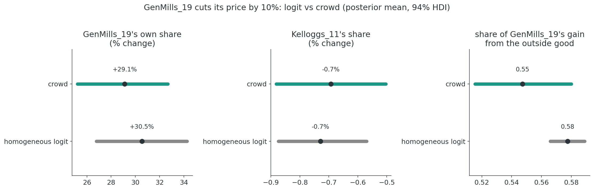

## Preliminaries {.smaller}

:::{.callout-warning}
## Who am I?
- I'm a __data scientist__ at __[PandaDoc]{.blue}__
    - Bayesian statistician,
    - Reformed philosopher and logician.
- Website: [https://nathanielf.github.io/](https://nathanielf.github.io/)
:::

{fig-align="center" width="150px"}

::: {.callout-tip}
## Code or it didn't Happen
The companion notebook builds every figure in this talk, from the first integral to the cereal counterfactual: [here](https://github.com/NathanielF/NathanielF.github.io/blob/master/talks/pycon_ireland_2026_blp/notebook/synthetic_crowd.ipynb). The model ships as `BayesianBLP` in [PyMC-Marketing](https://www.pymc-marketing.io).
:::


## The Pitch

How much would sales of Corn Flakes fall if a competitor cut prices by **10%**?

. . .

Answering needs a demand model, and real markets are full of things nobody observes:

- how much each **individual** cares about price versus quality,
- the unmeasured **appeal** of a product that drives both its price and its sales,
- the **composition** of the customer base itself.

. . .

**The argument:** the Berry–Levinsohn–Pakes model is a stack of integrals over a crowd we never see. Treat the [**crowd's composition as a latent variable**]{.blue} and the classical computational tricks become a generative model.

::: {.notes}
The opening question is the one every pricing team asks. The data they have are market shares: what fraction of shoppers bought each brand, in each city, each quarter. What they need is a model of the people behind those shares. BLP is the standard answer in industrial organisation. My claim today is that the heart of BLP is integration, three integrals nested inside each other, and that once you see that, the Bayesian version writes itself: the composition of the crowd stops being a numerical device and becomes a latent variable in the model.
:::


## Agenda

::: {.fragment .fade-in}
**Act I: The Crowd Behind the Shares.** What aggregate data hide, and why the crowd changes the answer
:::
::: {.fragment .fade-in}
**Act II: Integration All the Way Down.** How economists handle the crowd, and the Bayesian alternative
:::
::: {.fragment .fade-in}
**Act III: Building the Crowd in PyMC.** A Bayesian BLP from scratch, then the library
:::
::: {.fragment .fade-in}
**Act IV: Counterfactual Markets.** Nevo's cereal, and whether the crowd mattered
:::


# Act I: The Crowd Behind the Shares {background-color="#2a3439"}


## What We Observe {.smaller}
### and what we don't

::::{.columns}
:::{.column width="55%"}

Nevo's (2000) cereal panel: one row per brand, city and quarter.

| brand | share | price | sugar | mushy |
|---|---|---|---|---|
| Kelloggs_4 | 0.0124 | 0.072 | 2 | 1 |
| Kelloggs_6 | 0.0078 | 0.114 | 18 | 1 |
| Kelloggs_7 | 0.0130 | 0.132 | 4 | 1 |
| Kelloggs_9 | 0.0058 | 0.130 | 3 | 0 |

24 brands × 47 cities × 2 quarters. Inside shares sum to about 0.48; the rest buy no cereal.

:::
:::{.column width="45%"}

::: {.callout-important}
## Never observed
- **Who** bought: their price sensitivity, their taste for sugar
- **Why** a brand sells beyond its price and characteristics: its unmeasured appeal $\xi_{jm}$
- **How** the crowd is composed, market by market
:::

::: {.fragment .fade-in}
A share is the *average* decision of a crowd. To answer "what if?", we need the crowd.
:::

:::
::::

::: {.notes}
This is what scanner-style data look like: shares, prices and a few characteristics. No individuals. Everything that drives a counterfactual, how sensitive people are to price, and how differently, and the parts of a brand's appeal we don't measure, is missing. A share is an average over a crowd. If you only model the average, you only ever get answers that are true of an average person, and as we'll see in a moment, the crowd is not its average member.
:::


## Demand Is an Integral {.smaller}

BLP (1995): consumer $i$ in market $m$ gets utility from product $j$

$$u_{ijm} = \color{teal}{\delta_{jm}} + \color{blue}{\sigma\, \nu_i\, p_{jm}} + \varepsilon_{ijm}, \qquad \color{teal}{\delta_{jm} = \alpha p_{jm} + x_{jm}'\beta + \xi_{jm}}$$

[mean utility, shared by everyone]{style="color: teal;"} + [this consumer's deviation]{style="color: blue;"} + idiosyncratic shock

and the market share is the fraction of the crowd for whom $j$ is best:

$$s_{jm} = \int \frac{\exp(\delta_{jm} + \sigma \nu\, p_{jm})}{1 + \sum_k \exp(\delta_{km} + \sigma \nu\, p_{km})}\, dF(\nu)$$

. . .

- $\alpha$: the **average** consumer's price sensitivity; $\sigma$: how **differently** consumers feel about price
- $\xi_{jm}$: the brand's **unmeasured appeal** in that market
- No closed form: we approximate the integral with a **population of synthetic consumers**.

::: {.notes}
Here is the model in one line. Mean utility delta collects what everyone shares: price times the average sensitivity, characteristics, and xi, the unmeasured appeal. Each consumer then deviates through nu, their personal taste shock, scaled by sigma. The share is an integral over the distribution of nu, and it has no closed form. So we approximate it with a fixed population of synthetic consumers, and average their choices. Let me show you what that crowd looks like before we talk about how to estimate anything.
:::


## The Synthetic Crowd {.smaller}

{fig-align="center" width="92%"}

Price sensitivity varies, $\alpha_i = \alpha + \sigma\nu_i$. Each of 500 synthetic consumers has their own choice probabilities; the share is the **crowd's average**. The crowd buys the premium product at **22%**; its "average member" would buy it at **9%**.

::: {.notes}
Here is a market of three products: a budget, a mid-range and a premium cereal. On the left, five hundred synthetic consumers sorted from most price-sensitive to least. The sensitive ones mostly buy nothing or the budget option; the insensitive tail buys premium. The market share is the average of these columns. On the right, the punchline: averaging the crowd's choices is not the same as asking the average consumer. The crowd buys premium at twenty-two percent; the average consumer at nine. Nonlinearity makes the crowd matter.
:::


## Same Shares, Different Crowds {.smaller}

{fig-align="center" width="78%"}

A logit and a crowd fitted to the **same** shares. In the crowd, premium buyers sit in the insensitive tail and mid-range buyers are their nearest neighbours, so a 10% premium price rise sends **28%** of lost customers to mid-range (logit: 15%).

::: {.notes}
This is why the crowd is worth the trouble. I take the shares from the last slide as data and fit two models to them exactly: a homogeneous logit, and a crowd with sigma 0.9. Both match the data perfectly, but they describe different people. On the left I split the crowd by what each consumer buys. Premium buyers sit out in the price-insensitive tail, and mid-range buyers are their nearest neighbours. In the logit, everyone sits on the dashed line. Now raise the premium price. The logit has the independence of irrelevant alternatives, so lost customers spread in proportion to market share, and seventy-three percent leave the category. The crowd sends them to the product that people like them already buy. Same data, different counterfactual. Shares alone can't decide between the two, which is why we need a model of the crowd, and a way to estimate it.
:::


# Act II: Integration All the Way Down {background-color="#2a3439"}


## Integration Is Averaging {.smaller}

::::{.columns}
:::{.column width="40%"}


$$\int f(\nu)\, dF(\nu) \approx \frac{1}{R}\sum_{r=1}^{R} f(\nu_r)$$

Each point $\nu_r$ is one **synthetic consumer**. Scrambled Halton points spread out on purpose; random draws clump.

:::
:::{.column width="60%"}


::: {.fragment .fade-in}
On a three-dimensional share integral, a crowd of 8,192 Halton consumers is about **33× more accurate** than a random one of the same size.
:::

:::
::::

::: {.notes}
How do we compute that integral? An integral against a distribution is an expectation, and an expectation is approximated by an average over points. The question is which points. Random draws clump in some places and leave holes in others. Scrambled Halton sequences fill the space evenly. On the right, a real three-dimensional share integral: random crowds improve at the familiar one over root R; Halton crowds much faster, about thirty times more accurate at eight thousand consumers. For a model that evaluates this integral at every step of the sampler, that decides whether it's practical.
:::


## The Classical Estimator {.smaller}
### A nested fixed point

::::{.columns}
:::{.column width="55%"}

For every guess of $\sigma$:

1. **Invert** the shares: find $\delta$ that reproduces them exactly, by Berry's contraction mapping
$$\delta^{(t+1)} = \delta^{(t)} + \log s^{\text{obs}} - \log \hat s\big(\delta^{(t)}; \sigma\big)$$
2. **Recover** $\xi = \delta - \alpha p - x'\beta$
3. **Score** the guess with GMM: instruments $z$ must be uncorrelated with $\xi$

:::
:::{.column width="45%"}

```{.python}
def invert_shares(s_obs, sigma, nu, price):
    delta = np.log(s_obs) - np.log(1 - s_obs.sum())
    while True:
        s_hat = crowd_shares(delta, sigma, nu, price)
        step = np.log(s_obs) - np.log(s_hat)
        delta = delta + step
        if np.abs(step).max() < 1e-12:
            return delta
```

::: {.fragment .fade-in}
Powerful, but **computationally delicate**: the inner loop's tolerance leaks into the outer estimates (Dubé, Fox & Su, 2012), and uncertainty is a delta-method afterthought.
:::

:::
::::

::: {.notes}
This is how economists estimate it. The classical estimator wraps one optimisation inside another. Outside, GMM searches over sigma. Inside, for every candidate sigma, Berry's contraction mapping inverts the observed shares to find the mean utilities that reproduce them exactly: that's how I fitted the crowd to the same shares in Act One. From those come the structural errors xi, which the instruments must be orthogonal to. It works, and it is the workhorse of empirical IO. But it is delicate. Dubé, Fox and Su showed that loose inner tolerances produce wrong outer estimates. And the uncertainty you report is bolted on afterwards.
:::


## The Bayesian Reframing {.smaller}
### Every trick has a probabilistic counterpart

| Classical device | Bayesian counterpart |
|---|---|
| Simulation draws to approximate the share integral | A **fixed synthetic crowd**: Halton consumers as data |
| Contraction mapping to invert shares for $\delta$ | **No inversion**: $\xi_{jm}$ is sampled as a latent variable |
| GMM moment conditions $\mathbb{E}[z\,\xi] = 0$ | A **joint model** of the price equation and $\xi$ (a control function) |
| Standard errors by the delta method | **Posterior integration**: every quantity is averaged over the posterior |

. . .

Jiang, Manchanda & Rossi (2009) gave BLP a Bayesian likelihood but still ran the contraction **inside every MCMC step**. Sampling $\xi$ directly removes the inner loop, in the spirit of Dubé, Fox & Su's MPEC: unknowns become parameters, not a fixed point.

::: {.notes}
This is the reframing in one table. Each piece of computational machinery in classical BLP corresponds to something natural in a generative model. The simulation draws become a population of synthetic consumers the model carries around as data. The moment conditions become a joint model of how prices were set. And uncertainty is not an afterthought: it is the posterior. A note on history: Jiang, Manchanda and Rossi gave BLP a proper Bayesian likelihood, but they still invert the shares with the contraction mapping at every MCMC step. The version in PyMC-Marketing samples xi directly as a latent variable, so there is no inner loop at all. It's the same idea as Dubé, Fox and Su's MPEC: stop solving for the unknowns in an inner loop and make them parameters.
:::


## We Don't Know the Crowd {.smaller}

::::{.columns}
:::{.column width="35%"}

Everything so far assumed $\alpha$ and $\sigma$ were known. They aren't.

::: {.fragment .fade-in}
- The Halton points are **fixed**, standardised people $\nu_r$.
- Priors on $(\alpha, \sigma, \beta, \xi)$; the posterior moves the crowd $\alpha + \sigma\nu_r$.
- **Each posterior draw is a different crowd.**
:::

::: {.fragment .fade-in}
*The licence:* shoppers are exchangeable **given their market and taste profile**, so de Finetti's theorem says their choices are draws given a latent parameter with a prior. The crowd's composition is that parameter.
:::

:::
:::{.column width="65%"}


:::
::::

::: {.notes}
The third integral is the Bayesian one. We never know the crowd. The Halton points never change; they are standardised people. What the posterior moves is the mapping from those standard tastes to actual price sensitivities. Each teal curve is one posterior draw: one complete, plausible crowd. The dashed orange curve is the crowd that actually generated the data, and a homogeneous logit sees only the dotted line. Why is this legitimate? Shoppers are not identical, but once you fix their market and their taste profile they are interchangeable. De Finetti's representation theorem then says their choices can be modelled as draws given a latent parameter, with a prior over it. The crowd's composition is that parameter.
:::


## Three Integrals, One Equation {.smaller}

::: {style="font-size: 1.5em;"}
$$\mathbb{E}[\text{elasticity} \mid \text{shares}] = \color{blue}{\int_\theta} \color{teal}{\int_\nu} \color{gray}{\int_\varepsilon} (\cdots)\, \color{gray}{dF(\varepsilon)}\, \color{teal}{dF(\nu)}\, \color{blue}{p(\theta \mid \text{shares})\, d\theta}$$
:::

:::: {.columns}
::: {.column width="33%"}
::: {.fragment .fade-in}
[**Gumbel shocks**]{style="color: gray;"}

The softmax is already an integral over idiosyncratic shocks, with a closed form (McFadden, 1974). Free.
:::
:::
::: {.column width="33%"}
::: {.fragment .fade-in}
[**The crowd**]{style="color: teal;"}

Halton average over synthetic consumers, inside the model.
:::
:::
::: {.column width="33%"}
::: {.fragment .fade-in}
[**The posterior**]{style="color: blue;"}

MCMC average over every crowd consistent with the shares.
:::
:::
::::

. . .

Elasticities, diversion ratios and counterfactual shares are all the **same nested average**, evaluated at different prices.

::: {.notes}
Here is the whole structure in one line. Innermost, the Gumbel shocks. The logit formula you know is itself the solution of an integral: the probability a product wins a utility contest when every option gets a random shock, which McFadden showed has a closed form. In the middle, the crowd: averaged over Halton consumers inside the model. Outermost, the posterior: averaged by MCMC over every crowd consistent with the data. Every quantity a pricing team cares about is this same nested average, evaluated at a different set of prices. Once you see the nesting, there is no separate machinery for uncertainty. It falls out of the outer integral.
:::


# Act III: Building the Crowd in PyMC {background-color="#2a3439"}


## A Bayesian BLP from Scratch {.smaller}

::::{.columns}
:::{.column width="68%"}

```{.python code-line-numbers="|2-5|6-9|11-13|15-18|20-22"}
with pm.Model(coords=coords) as blp_from_scratch:
    # The average consumer, and the spread of the crowd
    alpha = pm.Normal("alpha", 0, 2)
    sigma = pm.HalfNormal("sigma", 1)
    beta = pm.Normal("beta", 0, 1, dims="characteristic")
    # Unmeasured appeal: product effect + market shocks
    xi_j = pm.Normal("xi_j", 0, 0.5, dims="product")
    sigma_xi = pm.HalfNormal("sigma_xi", 0.5)
    xi = xi_j + sigma_xi * pm.Normal("xi_raw", 0, 1, dims=("market", "product"))

    # Mean utility (M, J), then every consumer's utility (M, J, R)
    delta = alpha * P + (X * beta).sum(-1) + xi
    utility = delta[:, :, None] + sigma * crowd[None, None, :] * P[:, :, None]

    # Integrate the logit over the crowd: .mean(axis=-1) IS the integral
    u_full = pt.concatenate([utility, pt.zeros((M, 1, R))], axis=1)
    shares = pt.special.softmax(u_full, axis=1).mean(axis=-1)
    log_ratio = pt.log(shares[:, :J]) - pt.log(shares[:, J])[:, None]

    # Berry (1994) log-share-ratio likelihood
    pm.Normal("log_share_ratio", mu=log_ratio, sigma=noise,
              observed=np.log(S) - np.log(S0)[:, None])
```

:::
:::{.column width="32%"}

$$\hat s_{jm} = \color{teal}{\frac{1}{R}\sum_r} \text{softmax}_j\big(\delta_{jm} + \sigma \color{teal}{\nu_r} p_{jm}\big)$$

::: {.fragment .fade-in}
**The engineering**

- The crowd is a `pm.Data` vector of 200 Halton draws: data, not parameters.
- Broadcasting builds a markets × products × consumers tensor; no Python loops.
- `.mean(axis=-1)` is the whole share integral.
- 40 markets × 3 products fit in 21 s with nutpie.
:::

:::
::::

::: {.notes}
Code or it didn't happen. This is the whole model. First the preferences: average price sensitivity alpha, the spread of the crowd sigma, characteristic weights beta. Then the unmeasured appeal xi, a product effect plus market-level shocks, non-centred for the sampler. Then utility: mean utility, plus each synthetic consumer's deviation, sigma times their Halton draw times price. Broadcasting turns that into one tensor with an axis for markets, products and consumers. Then the integral: softmax over products for every consumer, then a mean over the consumer axis. That one mean is the share integral. Finally Berry's likelihood on the log share ratio. Notice what isn't here: no contraction mapping, no inversion, no GMM.
:::


## Recovering the Crowd {.smaller}

{fig-align="center" width="95%"}

::::{.columns}
:::{.column}
- Simulated panel: 40 markets × 3 products, true $\alpha = -2$, $\sigma = 0.6$.
- Zero divergences; the 94% intervals for $\alpha$ and both $\beta$s cover the truth.
:::
:::{.column}
::: {.fragment .fade-in}
- $\sigma$ is the hardest: its interval [0.604, 0.750] **just misses** the true 0.6, slightly overstating the crowd's spread. Heterogeneity is identified by how shares *bend* across price, a second-order signal in aggregate data.
:::
:::
::::

::: {.notes}
Does it work? Mostly. On a simulated panel with known truth there are zero divergences, and the price coefficient and characteristic weights are recovered. The honest detail is sigma, the crowd's spread. Its interval starts at 0.604, just above the true 0.6, so the model slightly overstates how heterogeneous the crowd is. That's typical: heterogeneity is identified from the curvature of shares across markets with different prices, which is a subtle signal in aggregate data.
:::


## `BayesianBLP` in PyMC-Marketing {.smaller}

```{.python code-line-numbers="|1-6|7-9|10-11|12-13"}
model = BayesianBLP(
    market_data=nevo,                      # long format: one row per market × product
    characteristics=["sugar", "mushy"],
    instruments=[f"z{i}" for i in range(6, 11)],    # price equation for endogenous prices
    random_coef_on=["price", "sugar", "mushy"],     # a three-dimensional crowd
    region_col="region", time_col="period", n_mc_draws=200,
    hierarchical_parameterisation="noncentered",    # few markets per city
    model_config={"alpha": Prior("Normal", mu=0, sigma=3),       # what this data needed
                  "sigma_xi_j": Prior("HalfNormal", sigma=0.25)},
)
model.fit(nuts_sampler="nutpie", draws=2000, tune=1000, chains=4,
          target_accept=0.95, init="adapt_full")    # funnel-prone ξ block
elasticities = model.elasticities(at="samples")
cf = model.counterfactual_shares(price_change={"GenMills_19": -0.10})
```

::: {.fragment .fade-in}
- **Endogenous prices**: firms price up appealing products, so price and $\xi$ are correlated. The price equation with instruments models them jointly.
- **The defaults were not enough** for Nevo: a wider price prior, a non-centred hierarchy, `adapt_full` and a high `target_accept`. Fit time: 3.3 minutes, zero divergences.
:::

::: {.notes}
Everything we've built is packaged in one class, and I want to show you what it actually took on real-shaped data rather than pretend the defaults just work. You hand it a long-format panel, name the characteristics and the instruments, and choose which dimensions get random coefficients: here price, sugar and mushiness, so the synthetic crowd lives in three dimensions. The instruments matter because firms price up their most appealing products, so price and unmeasured appeal are correlated; the class models the price equation jointly with xi. For Nevo's data I needed a wider prior on price, a non-centred hierarchy because each city has only two markets, a full-rank mass-matrix initialisation and a high target acceptance. With those, it fits in a few minutes without divergences.
:::


# Act IV: Counterfactual Markets {background-color="#2a3439"}


## Nevo's Cereal Panel {.smaller}

::::{.columns}
:::{.column width="55%"}

The standard benchmark for BLP: Nevo's (2000) *Practitioner's Guide*.

- 24 brands, 8 cities × 2 quarters (16 markets) for a few-minute fit
- Price in cents; sugar and mushiness as characteristics
- Hausman instruments: the brand's price in **other** cities
- Three-dimensional crowd of 200 Halton consumers

[Nevo's panel is simulated to resemble the cereal market, and brand names are coded.]{style="font-size: 0.8em; color: #888;"}

:::
:::{.column width="45%"}

::: {.fragment .fade-in}
::: {.callout-note}
## What the posterior says about this crowd
- Average price coefficient $\alpha = -0.33$ (price in cents)
- Spread of price sensitivity across the crowd: **0.15** [0.11, 0.19]
- Prices are endogenous: $\rho(\xi, \eta) = 0.33$ [0.11, 0.52]

(89% intervals.) A real but **modest** spread. Does it change the answer to the Corn Flakes question?
:::
:::

:::
::::

::: {.notes}
Now the benchmark everyone uses. Nevo's cereal data: twenty-four brands, prices, two characteristics, and Hausman instruments, the same brand's price in other cities. I fit a subset of eight cities so it runs in minutes. The data are simulated to look like the cereal market, and the brands are coded, so I can't actually tell you which one is Corn Flakes. What does the posterior say about the crowd? Price sensitivity does vary across consumers, but the spread is modest relative to the average, and prices are endogenous, so the instruments are earning their keep. Keep that modest spread in mind; it matters in two slides' time. If asked: the data carry no market sizes, so I use a placeholder of a thousand, which affects how residuals split between noise and appeal; and because sugar and mushiness never vary within a brand, those coefficients compete with the brand effects, much as a categorical variable competes with an intercept.
:::


## Elasticities with Uncertainty {.smaller}

::::{.columns}
:::{.column width="58%"}


:::
:::{.column width="42%"}

- Own-price elasticities from **−2.4 to −2.9**, median **−2.78**.
- Every brand gets a **full posterior**, not a delta-method standard error.

::: {.fragment .fade-in}
- Wide intervals flag brands whose demand the data pin down poorly. Kelloggs_11, our stand-in for Corn Flakes, is one of them: worth knowing before you price it.
:::

:::
::::

::: {.notes}
The first test of any demand model is whether the elasticities are sensible. Here every brand loses between about two and a half and three percent of its share for each one percent price rise. But look at the widths. Most brands are tightly estimated; a few have intervals stretching much closer to zero, and one of them is Kelloggs_11, the brand I'll treat as our Corn Flakes. That is the model telling you where its knowledge runs out, and a pricing team should hear it before setting a price.
:::


## The Corn Flakes Question {.smaller}
### A competitor cuts its price by 10%

{fig-align="center" width="58%"}

GenMills_19 cuts its price by 10% and gains about **29%** share [25%, 33%]. Kelloggs_11, our largest Kellogg's brand, loses about **0.7%** [0.5%, 0.9%]. Only **4%** of the competitor's gain comes from us; **55%** comes from people who weren't buying cereal at all.

::: {.notes}
Back to the opening question. Kelloggs_11 is the largest Kellogg's brand in the subset; call it our Corn Flakes. The largest General Mills brand cuts its price by ten percent. The model holds every market's unmeasured appeal fixed and re-integrates over the crowd at the new prices, once per posterior draw. The competitor's share jumps by about twenty-nine percent. Ours falls by under one percent. And most of the competitor's gain comes from people who weren't buying cereal at all. Now the honest question: is that the crowd talking, or would any demand model say it?
:::


## Did the Crowd Matter Here? {.smaller}
### The same question, asked of a homogeneous logit

{fig-align="center" width="92%"}

Refit with `random_coef_on=[]`: the same data, instruments and priors, but one taste for everyone. The answers barely move: GenMills_19 **+30.5%** vs **+29.1%**, Kelloggs_11 **−0.73%** vs **−0.69%**, and **58%** vs **55%** of the gain from the outside good. **For this question, the posterior says the crowd is doing little work.**

::: {.notes}
So I asked the same question of a homogeneous logit: same data, same instruments, same priors, but everyone shares one set of tastes. And the answers barely move. The competitor gains thirty and a half percent instead of twenty-nine; we lose about the same; the outside good supplies fifty-eight percent of the gain instead of fifty-five, and the intervals overlap throughout. I want to be straight about this, because it would be easy to pretend otherwise. On this question, in this data, the crowd isn't changing the answer. Two brands at similar prices, and a crowd whose spread of price sensitivity is real but modest, so the logit's simple substitution pattern is close enough. That isn't a failure of the approach. Earlier we saw a market where the crowd changed the counterfactual completely. Here it doesn't. You only know which world you are in because the crowd is in the model, and the posterior can tell you when it matters and when you could have done without it.
:::


## Conclusion {.smaller}
### The Crowd Is a Latent Variable

::::{.columns}
:::{.column}

> "The representation theorem ... proves that if observations are judged to be exchangeable, then they must indeed be a random sample from some model and there must exist a prior probability distribution over the parameter of the model, hence requiring a Bayesian approach."

-- José Bernardo, _The Concept of Exchangeability and its Applications_ (1996)

:::
:::{.column}

::: {.fragment .fade-in}
- The **average consumer** can mislead: identical shares can hide crowds with different counterfactuals.
:::

::: {.fragment .fade-in}
- BLP is **three nested integrals**: Gumbel shocks in closed form, the crowd by Halton averaging, the parameters by the posterior.
:::

::: {.fragment .fade-in}
- Treat the crowd's composition as a **latent parameter with a prior**, and the classical machinery dissolves into one PyMC model. The posterior then tells you, market by market, **whether the crowd mattered**.
:::

:::
::::

::: {.notes}
Bernardo's summary of de Finetti is the licence for everything in this talk. If we judge shoppers exchangeable once we account for their market and their taste profile, then their choices must be modelled as draws from some model given a parameter, with a prior over that parameter. The composition of the crowd is that parameter. We never observe it; we infer it. A model that collapses it to one average person can fit the shares perfectly and still get the counterfactual wrong, as the synthetic market showed. Or, as Nevo's cereal showed, it can turn out to be fine. The point of putting the crowd in the model is that the posterior tells you which, with the inversion and moment conditions gone and uncertainty carried through every number.
:::


## {background-color="black"}

::: {style="color: white; font-size: 1.6em; font-weight: bold; text-align: center; margin-top: 150px;"}
"The crowd is not a numerical trick.

Its shape is what we infer."
:::


## Resources {.smaller}

:::: {.columns}
::: {.column width="60%"}

:::{.callout-tip}
## Resources
- Companion notebook: [github.com/NathanielF/.../synthetic_crowd.ipynb](https://github.com/NathanielF/NathanielF.github.io/blob/master/talks/pycon_ireland_2026_blp/notebook/synthetic_crowd.ipynb)
- PyMC-Marketing: [pymc-marketing.io](https://www.pymc-marketing.io), `BayesianBLP` and its synthetic and Nevo example notebooks
- Berry, Levinsohn & Pakes (1995), "Automobile Prices in Market Equilibrium," *Econometrica*
- Berry (1994), "Estimating Discrete-Choice Models of Product Differentiation," *RAND J. Econ.*
- Nevo (2000), "A Practitioner's Guide to Estimation of Random-Coefficients Logit Models of Demand," *JEMS*
- Jiang, Manchanda & Rossi (2009), "Bayesian Analysis of Random Coefficient Logit Models Using Aggregate Data," *J. Econometrics*
- Dubé, Fox & Su (2012), "Improving the Numerical Performance of ... Random Coefficients Demand Estimation," *Econometrica*
- Bernardo (1996), "The Concept of Exchangeability and its Applications," *Far East J. Math. Sci.*
- Train (2009), *Discrete Choice Methods with Simulation*
:::

:::
::: {.column width="40%"}
{fig-align="center" width="62%"}
:::
::::

::: {.notes}
One last plug. Ben Vincent and I have a book coming out, Bayesian Causal Inference. Its discrete choice chapter is the individual-level twin of this talk: the same questions about substitution patterns, endogeneity and counterfactual prices, asked of individual choices rather than market shares. If today's crowd interested you, that chapter shows the people inside it.
:::
