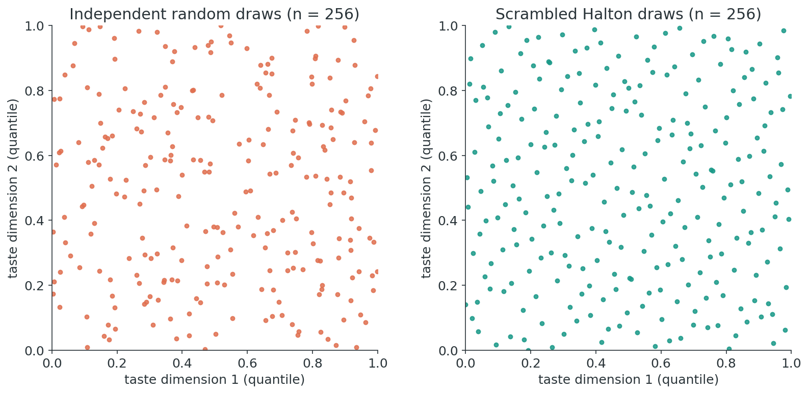
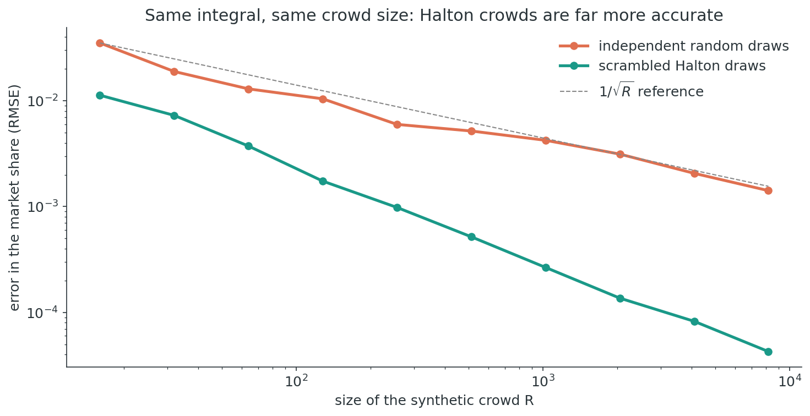
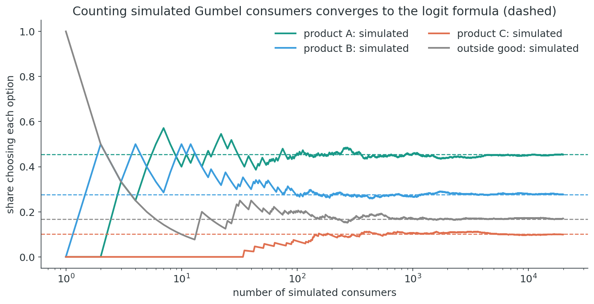
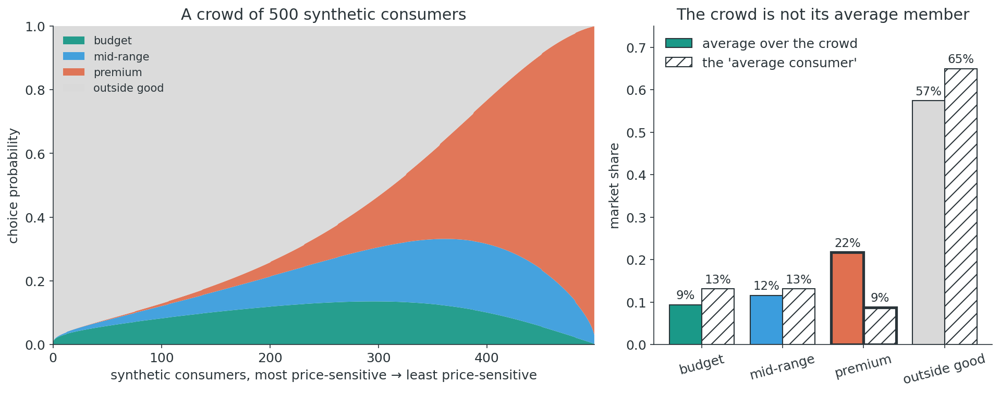
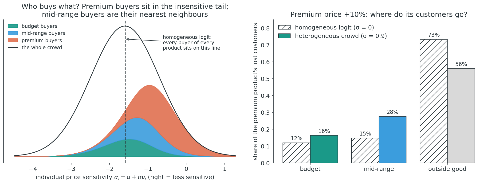
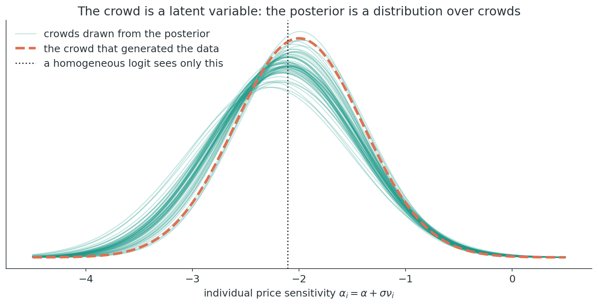
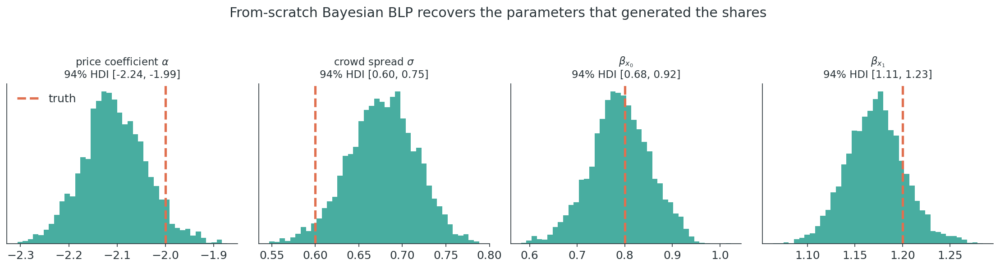
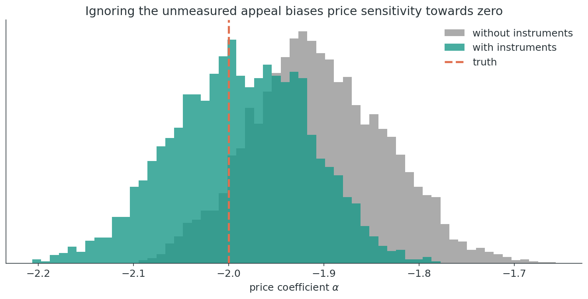
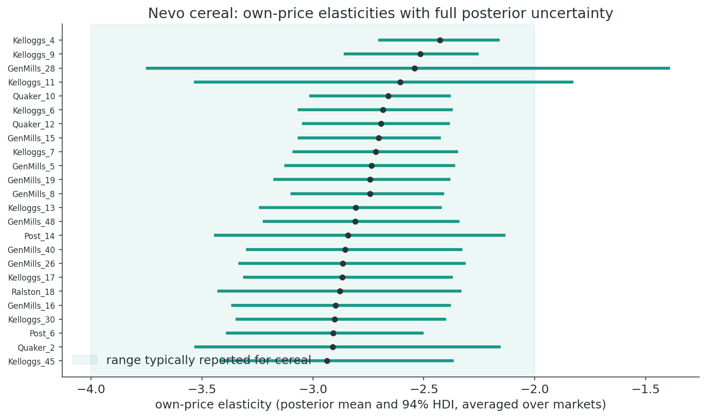
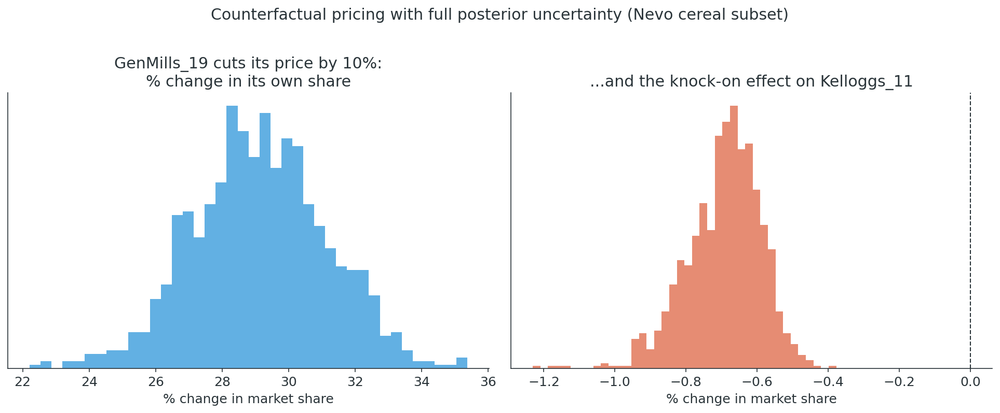

## Preliminaries {.smaller}

:::{.callout-warning}
## Who am I?
- I'm a __data scientist__ at __[PandaDoc]{.blue}__
    - Bayesian statistician,
    - Reformed philosopher and logician.
- Website: [https://nathanielf.github.io/](https://nathanielf.github.io/)
:::

{fig-align="center" width="150px"}

::: {.callout-tip}
## Code or it didn't Happen
The companion notebook builds every figure in this talk, from the first integral to the cereal counterfactual: [here](https://github.com/NathanielF/NathanielF.github.io/blob/master/talks/pycon_ireland_2026_blp/notebook/synthetic_crowd.ipynb). The model ships as `BayesianBLP` in [PyMC-Marketing](https://www.pymc-marketing.io).
:::


## The Pitch

How much would sales of Corn Flakes fall if a competitor cut prices by **10%**?

. . .

Answering needs a demand model, and real markets are full of things nobody observes:

- how much each **individual** cares about price versus quality,
- the unmeasured **appeal** of a product that drives both its price and its sales,
- the **composition** of the customer base itself.

. . .

**The argument:** the Berry–Levinsohn–Pakes model is a stack of integrals over a crowd we never see. Treat that [**crowd as a latent variable**]{.blue} and the classical computational tricks become a generative model.

::: {.notes}
The opening question is the one every pricing team asks. The data they have are market shares: what fraction of shoppers bought each brand, in each city, each quarter. What they need is a model of the people behind those shares. BLP is the standard answer in industrial organisation. My claim today is that the heart of BLP is integration, three integrals nested inside each other, and that once you see that, the Bayesian version writes itself: the population of consumers stops being a numerical device and becomes a latent variable in the model.
:::


## Agenda

::: {.fragment .fade-in}
**Act I: The Crowd Behind the Shares.** What aggregate data hide, and how classical BLP inverts its way back
:::
::: {.fragment .fade-in}
**Act II: Integration All the Way Down.** Three nested integrals, built up one layer at a time
:::
::: {.fragment .fade-in}
**Act III: Building the Crowd in PyMC.** A Bayesian BLP from scratch, then with endogenous prices
:::
::: {.fragment .fade-in}
**Act IV: Counterfactual Markets.** Nevo's cereal: elasticities and the Corn Flakes question
:::


# Act I: The Crowd Behind the Shares {background-color="#2a3439"}


## What We Observe {.smaller}
### and what we don't

::::{.columns}
:::{.column width="55%"}

Nevo's (2000) cereal panel: one row per brand, city and quarter.

| brand | share | price | sugar | mushy |
|---|---|---|---|---|
| Kelloggs_4 | 0.0124 | 0.072 | 2 | 1 |
| Kelloggs_6 | 0.0078 | 0.114 | 18 | 1 |
| Kelloggs_7 | 0.0130 | 0.132 | 4 | 1 |
| Kelloggs_9 | 0.0058 | 0.130 | 3 | 0 |

24 brands × 47 cities × 2 quarters. Inside shares sum to about 0.48; the rest buy no cereal.

:::
:::{.column width="45%"}

::: {.callout-important}
## Never observed
- **Who** bought: their price sensitivity, their taste for sugar
- **Why** a brand sells beyond its price and characteristics: its unmeasured appeal $\xi_{jm}$
- **How** the crowd is composed, market by market
:::

::: {.fragment .fade-in}
A share is the *average* decision of a crowd. To answer "what if?", we need the crowd.
:::

:::
::::

::: {.notes}
This is what scanner-style data look like: shares, prices and a few characteristics. No individuals. Everything that drives a counterfactual, how sensitive people are to price, and how differently, and the parts of a brand's appeal we don't measure, is missing. A share is an average over a crowd. If you only model the average, you only ever get answers that are true of an average person, and as we'll see, the crowd is not its average member.
:::


## Demand Is an Integral {.smaller}

BLP (1995): consumer $i$ in market $m$ gets utility from product $j$

$$u_{ijm} = \color{teal}{\delta_{jm}} + \color{blue}{\sigma\, \nu_i\, p_{jm}} + \varepsilon_{ijm}, \qquad \color{teal}{\delta_{jm} = \alpha p_{jm} + x_{jm}'\beta + \xi_{jm}}$$

[mean utility, shared by everyone]{style="color: teal;"} + [this consumer's deviation]{style="color: blue;"} + idiosyncratic shock

and the market share is the fraction of the crowd for whom $j$ is best:

$$s_{jm} = \int \frac{\exp(\delta_{jm} + \sigma \nu\, p_{jm})}{1 + \sum_k \exp(\delta_{km} + \sigma \nu\, p_{km})}\, dF(\nu)$$

. . .

- $\alpha$: the **average** consumer's price sensitivity
- $\sigma$: how **differently** consumers feel about price
- $\xi_{jm}$: the brand's **unmeasured appeal** in that market
- No closed form: the integral over the crowd must be **approximated**.

::: {.notes}
Here is the model in one line. Mean utility delta collects what everyone shares: price times the average sensitivity, characteristics, and xi, the unmeasured appeal. Each consumer then deviates through nu, their personal taste shock, scaled by sigma. The share is an integral over the distribution of nu, and it has no closed form. That single fact drives everything about how BLP is estimated.
:::


## The Classical Estimator {.smaller}
### A nested fixed point

::::{.columns}
:::{.column width="55%"}

For every guess of $\sigma$:

1. **Invert** the shares: find $\delta$ that reproduces them exactly, by Berry's contraction mapping
$$\delta^{(t+1)} = \delta^{(t)} + \log s^{\text{obs}} - \log \hat s\big(\delta^{(t)}; \sigma\big)$$
2. **Recover** $\xi = \delta - \alpha p - x'\beta$
3. **Score** the guess with GMM: instruments $z$ must be uncorrelated with $\xi$

:::
:::{.column width="45%"}

```{.python}
def invert_shares(s_obs, sigma, nu, price):
    delta = np.log(s_obs) - np.log(1 - s_obs.sum())
    while True:
        s_hat = crowd_shares(delta, sigma, nu, price)
        step = np.log(s_obs) - np.log(s_hat)
        delta = delta + step
        if np.abs(step).max() < 1e-12:
            return delta
```

::: {.fragment .fade-in}
Powerful, but **computationally delicate**: the inner loop's tolerance leaks into the outer estimates (Dubé, Fox & Su, 2012), and uncertainty is a delta-method afterthought.
:::

:::
::::

::: {.notes}
The classical estimator wraps one optimisation inside another. Outside, GMM searches over sigma. Inside, for every candidate sigma, Berry's contraction mapping inverts the observed shares to find the mean utilities that reproduce them exactly, and from those the structural errors xi, which the instruments must be orthogonal to. It works, and it is the workhorse of empirical IO. But it is delicate. Dubé, Fox and Su showed that loose inner tolerances produce wrong outer estimates. And the uncertainty you report is bolted on afterwards.
:::


## The Bayesian Reframing {.smaller}
### Every trick has a probabilistic counterpart

| Classical device | Bayesian counterpart |
|---|---|
| Simulation draws to approximate the share integral | A **fixed synthetic crowd**: Halton consumers as data |
| Contraction mapping to invert shares for $\delta$ | **No inversion**: $\xi_{jm}$ is a latent variable with a prior |
| GMM moment conditions $\mathbb{E}[z\,\xi] = 0$ | A **joint model** of the price equation and $\xi$ |
| Standard errors by the delta method | **Posterior integration**: every quantity is averaged over the posterior |

. . .

Jiang, Manchanda & Rossi (2009) made the case for this model; PyMC-Marketing's `BayesianBLP` implements it. The rest of this talk builds the intuition for **why it works**: it is integration all the way down.

::: {.notes}
This is the reframing in one table. Each piece of computational machinery in classical BLP corresponds to something natural in a generative model. The simulation draws become a population of synthetic consumers that the model carries around as data. The inversion disappears, because xi is just another latent variable. The moment conditions become a joint model of how prices were set. And uncertainty is not an afterthought: it is the posterior. Jiang, Manchanda and Rossi made this argument for the random-coefficients logit on aggregate data; the PyMC-Marketing class implements it.
:::


# Act II: Integration All the Way Down {background-color="#2a3439"}


## Integration Is Averaging {.smaller}

::::{.columns}
:::{.column width="35%"}

Every integral in BLP is an expectation, so

$$\int f(\nu)\, dF(\nu) \approx \frac{1}{R}\sum_{r=1}^{R} f(\nu_r)$$

The only question is **which** points $\nu_r$ to average over.

::: {.fragment .fade-in}
- Random draws **clump** and leave **gaps**.
- Scrambled Halton draws **spread out** on purpose.
- Each point is one **synthetic consumer**.
:::

:::
:::{.column width="65%"}



:::
::::

::: {.notes}
Start at the bottom. An integral against a distribution is an expectation, and an expectation can be approximated by an average over points. The question is which points. Independent random draws clump together in some places and leave holes in others. Halton sequences are deterministic, low-discrepancy points that fill the space evenly; scrambling removes their artefacts. In BLP, each of these points is a person: one synthetic consumer with one set of tastes.
:::


## Halton Crowds Are Better Crowds {.smaller}

{fig-align="center" width="68%"}

The same three-dimensional share integral, approximated by crowds of different sizes. At 8,192 consumers the Halton crowd is about **33× more accurate** than a random one; random draws improve only at the $1/\sqrt{R}$ rate.

::: {.notes}
Here is why the choice matters. This is a real share integral, a mixed logit with three taste dimensions. The orange line is the error of random crowds as they grow; it falls at the familiar one over root R. The teal line is Halton crowds; it falls much faster. By eight thousand consumers it is more than thirty times more accurate. For a model that evaluates this integral at every gradient step of the sampler, that difference decides whether the model is practical.
:::


## Layer 1: The Logit Is Already an Integral {.smaller}

::::{.columns}
:::{.column width="38%"}

Each consumer adds an idiosyncratic Gumbel shock and picks the best option:

$$s_j = \int \mathbb{1}\big[j \text{ is best}\big]\, dF(\varepsilon) = \frac{e^{\delta_j}}{1 + \sum_k e^{\delta_k}}$$

::: {.fragment .fade-in}
McFadden (1974): for Gumbel shocks this integral has a **closed form**. Simulate and count, and you converge to it.
:::

:::
:::{.column width="62%"}



:::
::::

::: {.notes}
The first integral is one you may not have noticed. The logit formula is the probability that a product wins a utility contest when every option gets a random Gumbel shock. That's an integral over the shocks, and McFadden showed it has a closed form. On the right, I simulate twenty thousand consumers, give them Gumbel shocks, and count their choices. The running shares converge to the softmax. So when we write a softmax, we are already integrating; we just get to skip the work.
:::


## Layer 2: The Synthetic Crowd {.smaller}

{fig-align="center" width="92%"}

Price sensitivity varies, $\alpha_i = \alpha + \sigma\nu_i$. Each of 500 Halton consumers has their own choice probabilities; the share is the **crowd's average**. The crowd buys the premium product at **22%**; its "average member" would buy it at **9%**.

::: {.notes}
The second integral is the one BLP is famous for. Now the price coefficient varies across people. On the left, five hundred synthetic consumers, one Halton point each, sorted from most price-sensitive to least. The sensitive ones mostly buy nothing or the budget option; the insensitive tail buys premium. The market share is the average of these columns. On the right, the punchline: averaging the crowd's choices is not the same as asking the average consumer. The crowd buys premium at twenty-two percent; the average consumer at nine. Nonlinearity makes the crowd matter.
:::


## Same Shares, Different Crowds {.smaller}

{fig-align="center" width="78%"}

Berry's inversion fits a logit and a crowd to the **same** shares. Left: in the crowd, premium buyers sit in the insensitive tail and mid-range buyers are their nearest neighbours. So after a 10% premium price rise the crowd sends **28%** of lost customers to mid-range (logit: 15%); the logit sends **73%** out of the category.

::: {.notes}
This is why the crowd is worth the trouble. I take the shares from the last slide as data and fit two models to them exactly: a homogeneous logit, and a crowd with sigma 0.9. Fitting the crowd is Berry's contraction mapping, the code from Act One. Both models match the data perfectly, but they describe different people. On the left I split the crowd by what each consumer buys. Premium buyers sit out in the price-insensitive tail, and mid-range buyers are their nearest neighbours. In the logit, everyone sits on the dashed line. Now raise the premium price. The logit has the independence of irrelevant alternatives, so lost customers spread in proportion to market share, and most leave the category. The crowd sends them to the product that people like them already buy. Same data, different counterfactual. Shares alone can't decide between the two, which is why we need a model of the crowd.
:::


## Layer 3: We Don't Know the Crowd {.smaller}

::::{.columns}
:::{.column width="35%"}

Everything so far assumed $\alpha$ and $\sigma$ were known. They aren't.

::: {.fragment .fade-in}
- Put priors on $(\alpha, \sigma, \beta, \xi)$.
- The Halton points stay **fixed**.
- The posterior moves the parameters that turn $\nu_r$ into real sensitivities $\alpha + \sigma\nu_r$.
- **The crowd is a latent variable**: each posterior draw is a different crowd.
:::

:::
:::{.column width="65%"}



:::
::::

::: {.notes}
The third integral is the Bayesian one. We never know the crowd. So we put priors on the parameters that shape it and let the data speak. The Halton points never change; they are standardised people. What the posterior moves is the mapping from those standard tastes to actual price sensitivities. Each teal curve is one posterior draw: one complete, plausible crowd. The dashed orange curve is the crowd that actually generated the data. A homogeneous logit sees only the dotted line: one number for everybody.
:::


## De Finetti's Crowd {.smaller}
### Why BLP is a natural Bayesian case study

::::{.columns}
:::{.column width="58%"}

De Finetti (1937): **exchangeable** observations can be represented as independent draws given a latent parameter, mixed over a prior. Shoppers are not exchangeable outright, but they are **conditionally**:

::: {style="font-size: 0.8em;"}
$$p(y_{1}, \dots, y_{n} \mid m) = \int \prod_{i=1}^{n} \int p(y_{i} \mid m, \nu)\, dF(\nu \mid \color{teal}{\theta})\; \color{blue}{\pi(d\theta)}$$
:::

::: {.fragment .fade-in}
- Given the **market** $m$ (prices, characteristics, appeal $\xi$) and a **taste profile** $\nu$, two shoppers are interchangeable: each choice is a logit draw.
- Taste profiles are **latent**, so we integrate them over the [crowd $F(\nu \mid \theta)$]{style="color: teal;"}.
- **The crowd's composition $\theta$ is the de Finetti parameter.**
:::

:::
:::{.column width="42%"}

::: {.fragment .fade-in}
::: {.callout-important}
## The theorem guarantees a prior; BLP supplies one
> "...it generally does not specify the model, and it never specifies the required prior distribution." (Bernardo, 1996)

The Bayesian BLP fills [$\pi$]{style="color: blue;"} with structure:

- a **utility model** and a fixed Halton crowd,
- **product appeal** shared across markets,
- a **price equation** for why appealing products cost more,
- a **hierarchy**: markets are only *partially* exchangeable.
:::
:::

:::
::::

::: {.notes}
This is the reason I find BLP such an evocative Bayesian case study. De Finetti's representation theorem says that if you judge observations exchangeable, you may treat them as independent draws given some latent parameter, averaged over your beliefs about that parameter. Shoppers are not exchangeable outright: they face different prices and they have different tastes. But they are conditionally exchangeable. Fix the market, its prices, characteristics and unmeasured appeal, and fix a taste profile, and two shoppers are interchangeable: each choice is just a logit draw. We never see the taste profile, so we integrate it out over the crowd. That is the inner integral of the talk. And the composition of that crowd is the de Finetti parameter, with a prior over it. That is the outer integral. The nesting of the integrals is the nesting of the exchangeability judgements. But, as José Bernardo puts it, the theorem is an existence result: it tells you a model and a prior must exist, and never tells you which. That is where BLP earns its place as a case study. Economics supplies the structure: a utility model, product appeal shared across markets, a price equation explaining why appealing products cost more, and, because markets are similar but not identical, only partial exchangeability across them, which is exactly a hierarchical model across regions. That structure is what lets shares, which say very little on their own, identify a crowd.
:::


## Three Integrals, One Equation {.smaller}

::: {style="font-size: 1.5em;"}
$$\mathbb{E}[\text{elasticity} \mid \text{shares}] = \color{blue}{\int_\theta} \color{teal}{\int_\nu} \color{gray}{\int_\varepsilon} (\cdots)\, \color{gray}{dF(\varepsilon)}\, \color{teal}{dF(\nu)}\, \color{blue}{p(\theta \mid \text{shares})\, d\theta}$$
:::

:::: {.columns}
::: {.column width="33%"}
::: {.fragment .fade-in}
[**Gumbel shocks**]{style="color: gray;"}

Closed form: the softmax. Free.
:::
:::
::: {.column width="33%"}
::: {.fragment .fade-in}
[**The crowd**]{style="color: teal;"}

Halton average over synthetic consumers, inside the model.
:::
:::
::: {.column width="33%"}
::: {.fragment .fade-in}
[**The posterior**]{style="color: blue;"}

MCMC average over every crowd consistent with the shares.
:::
:::
::::

. . .

Elasticities, diversion ratios and counterfactual shares are all the **same nested average**, evaluated at different prices.

::: {.notes}
Here is the whole structure in one line. Innermost, the Gumbel shocks: integrated in closed form, the softmax. In the middle, the crowd: averaged over Halton consumers inside the model. Outermost, the posterior: averaged by MCMC over every crowd consistent with the data. Every quantity a pricing team cares about is this same nested average, evaluated at a different set of prices. Once you see the nesting, there is no separate machinery for uncertainty. It falls out of the outer integral.
:::


# Act III: Building the Crowd in PyMC {background-color="#2a3439"}


## A Bayesian BLP from Scratch {.smaller}

::::{.columns}
:::{.column width="68%"}

```{.python code-line-numbers="|2-5|6-9|11-13|15-18|20-22"}
with pm.Model(coords=coords) as blp_from_scratch:
    # The average consumer, and the spread of the crowd
    alpha = pm.Normal("alpha", 0, 2)
    sigma = pm.HalfNormal("sigma", 1)
    beta = pm.Normal("beta", 0, 1, dims="characteristic")
    # Unmeasured appeal: product effect + market shocks
    xi_j = pm.Normal("xi_j", 0, 0.5, dims="product")
    sigma_xi = pm.HalfNormal("sigma_xi", 0.5)
    xi = xi_j + sigma_xi * pm.Normal("xi_raw", 0, 1, dims=("market", "product"))

    # Mean utility, then each synthetic consumer's deviation
    delta = alpha * P + (X * beta).sum(-1) + xi
    utility = delta[:, :, None] + sigma * crowd[None, None, :] * P[:, :, None]

    # Integrate the logit over the crowd
    u_full = pt.concatenate([utility, pt.zeros((M, 1, R))], axis=1)
    shares = pt.special.softmax(u_full, axis=1).mean(axis=-1)
    log_ratio = pt.log(shares[:, :J]) - pt.log(shares[:, J])[:, None]

    # Berry (1994) log-share-ratio likelihood
    pm.Normal("log_share_ratio", mu=log_ratio, sigma=noise,
              observed=np.log(S) - np.log(S0)[:, None])
```

:::
:::{.column width="32%"}

$$\delta_{jm} = \alpha p_{jm} + x_{jm}'\beta + \xi_{jm}$$

$$u_{rjm} = \delta_{jm} + \sigma \color{teal}{\nu_r} p_{jm}$$

$$\hat s_{jm} = \color{teal}{\frac{1}{R}\sum_r} \text{softmax}_j(u_{rm})$$

$$\log \tfrac{s_{jm}}{s_{0m}} \sim N\Big(\log \tfrac{\hat s_{jm}}{\hat s_{0m}},\ \tfrac{1}{n s_{jm}} + \tfrac{1}{n s_{0m}}\Big)$$

:::
::::

::: {.notes}
Code or it didn't happen. This is the whole model. First the preferences: average price sensitivity alpha, the spread of the crowd sigma, characteristic weights beta. Then the unmeasured appeal xi, a product effect plus market-level shocks, non-centred for the sampler. Then utility: mean utility, plus each synthetic consumer's deviation, sigma times their Halton draw times price. Then the integral: softmax over products for every consumer, averaged over the crowd. That mean over the last axis is the entire share integral. Finally Berry's likelihood on the log share ratio, with variance from multinomial sampling. Notice what isn't here: no contraction mapping, no inversion, no GMM.
:::


## Recovering the Crowd {.smaller}

{fig-align="center" width="95%"}

::::{.columns}
:::{.column}
- Simulated panel: 40 markets × 3 products, true $\alpha = -2$, $\sigma = 0.6$.
- Zero divergences; the 94% intervals for $\alpha$ and both $\beta$s cover the truth.
:::
:::{.column}
::: {.fragment .fade-in}
- $\sigma$ is the hardest: its interval [0.60, 0.75] **narrowly misses** 0.6, slightly overstating the crowd's spread. Heterogeneity is identified by how shares *bend* across price, a second-order signal in aggregate data.
:::
:::
::::

::: {.notes}
Does it work? Mostly. On a simulated panel with known truth there are zero divergences, and the price coefficient and characteristic weights are recovered. The honest detail is sigma, the crowd's spread. Its interval sits just above the true value, so the model slightly overstates how heterogeneous the crowd is. That's typical: heterogeneity is identified from the curvature of shares across markets with different prices, which is a subtle signal in aggregate data. It's exactly why you want a posterior rather than a point estimate for it.
:::


## The Unmeasured Appeal {.smaller}
### Endogenous prices

::::{.columns}
:::{.column width="38%"}

Firms set prices knowing their product's appeal $\xi_{jm}$. Popular products get priced **up**.

::: {.fragment .fade-in}
- Ignore it, and "expensive *because* popular" looks like "consumers don't mind the price".
- `BayesianBLP` adds a first-stage **price equation** with instruments and models $\xi$ **jointly** with the price residual.
- Correlation $\rho(\xi, \eta)$: **0.51**, 89% interval [0.31, 0.68].
:::

:::
:::{.column width="62%"}



:::
::::

Simulated panel with `price_xi_corr = 0.6`. 94% HDIs. With instruments: **−1.99** [−2.12, −1.86]; without: **−1.91** [−2.04, −1.78]; truth **−2.0**.

::: {.notes}
Now the second hidden thing from the pitch: the unmeasured appeal that drives both price and sales. Firms see xi and price accordingly, so price and xi are correlated. A model that ignores this underestimates price sensitivity. BayesianBLP adds a first-stage price equation with instruments, cost shifters or rival characteristics, and models xi jointly with the price residual. On a simulated panel with strong endogeneity, the instrumented posterior centres on the truth; the uninstrumented one is pulled towards zero. To be candid, with this panel the gap is modest and the two intervals overlap. The clearer evidence is the endogeneity correlation itself, which the model estimates at about one half, well away from zero.
:::


## `BayesianBLP` in PyMC-Marketing {.smaller}

```{.python code-line-numbers="|1-9|10|11-12"}
model = BayesianBLP(
    market_data=df,                       # long format: one row per market × product
    characteristics=["sugar", "mushy"],
    instruments=[f"z{i}" for i in range(6, 11)],
    random_coef_on=["price", "sugar", "mushy"],   # three taste dimensions
    region_col="region", time_col="period",       # cities pool hierarchically
    n_mc_draws=200,                               # the synthetic crowd
    hierarchical_parameterisation="noncentered",
)
model.fit(nuts_sampler="nutpie", draws=2000, tune=1000, chains=4)
elasticities = model.elasticities(at="samples")
cf = model.counterfactual_shares(price_change={"GenMills_19": -0.10})
```

::: {.fragment .fade-in}
- **Hierarchical pooling** of price sensitivity across regions, cheap in a Bayesian model.
- **Elasticities** reuse the same crowd: the Halton average comes for free.
- **Counterfactuals** hold each market's posterior $\xi$ fixed and re-integrate over the crowd at new prices.
:::

::: {.notes}
Everything we've built is packaged in one class. You hand it a long-format panel, name the characteristics and instruments, and choose which dimensions get random coefficients: here price, sugar and mushiness, so the synthetic crowd lives in three dimensions. Regions pool hierarchically. After fitting, elasticities and counterfactuals are one call each, and both are the nested average from Act Two, evaluated at new prices.
:::


# Act IV: Counterfactual Markets {background-color="#2a3439"}


## Nevo's Cereal Panel {.smaller}

::::{.columns}
:::{.column width="55%"}

The standard benchmark for BLP: Nevo's (2000) *Practitioner's Guide*.

- 24 brands, 8 cities × 2 quarters (16 markets) for a few-minute fit
- Price in cents; sugar and mushiness as characteristics
- Hausman instruments: the brand's price in **other** cities
- Three-dimensional crowd of 200 Halton consumers

::: {.fragment .fade-in}
Zero divergences. Price coefficient $\alpha = -0.33$ (price in cents); crowd spread on price **0.15** [0.11, 0.19]; endogeneity $\rho = 0.33$ [0.11, 0.52] (89% intervals).
:::

:::
:::{.column width="45%"}

::: {.callout-warning}
## The Hard Truth
- Nevo's panel is **simulated** to resemble cereal; it is not scanner data.
- The data carry no market sizes: $n = 1{,}000$ is a **placeholder** that scales interval widths.
- Brand identities are **coded**; sugar and mushiness never vary within a brand, so they compete with brand effects.
:::

:::
::::

::: {.notes}
Now the benchmark everyone uses. Nevo's cereal data: twenty-four brands, prices, two characteristics, and Hausman instruments, the same brand's price in other cities. I fit a subset of eight cities so it runs in minutes. The fit is clean, and the model finds both heterogeneity in price sensitivity and endogeneity of prices. And the honest caveats: the data are simulated to look like cereal, there are no market sizes so I use a placeholder, and brands are coded, so I can't actually tell you which one is Corn Flakes.
:::


## Elasticities with Uncertainty {.smaller}

::::{.columns}
:::{.column width="62%"}



:::
:::{.column width="38%"}

- Own-price elasticities from **−2.4 to −2.9**, median **−2.78**: inside the range usually reported for cereal.
- Every brand gets a **full posterior**, not a delta-method standard error.

::: {.fragment .fade-in}
- Wide intervals flag brands whose demand the data pin down poorly. That is a business fact, not a nuisance.
:::

:::
::::

::: {.notes}
The first test of any demand model is whether the elasticities are sensible. Here they run from about minus two and a half to just under minus three, which is where the cereal literature puts them. But look at the widths. Most brands are tightly estimated; a few, like GenMills_28 and Kelloggs_11, have intervals stretching well above minus two. That is the model telling you where its knowledge runs out, and a pricing team should hear it.
:::


## The Corn Flakes Question {.smaller}
### A competitor cuts its price by 10%

{fig-align="center" width="66%"}

GenMills_19 cuts its price by 10% and gains about **29%** share [25%, 33%]. Kelloggs_11, our largest Kellogg's brand, loses about **0.7%** [0.5%, 0.9%]. Only **4%** of the competitor's gain comes from us; **55%** comes from people who weren't buying cereal at all.

::: {.notes}
Back to the opening question. Kelloggs_11 is the largest Kellogg's brand in the subset; call it our Corn Flakes. The largest General Mills brand cuts its price by ten percent. The model holds every market's unmeasured appeal fixed and re-integrates over the crowd at the new prices, once per posterior draw. The competitor's share jumps by about twenty-nine percent. Ours falls by under one percent. The striking part is where the gain comes from: only four percent from us, and more than half from consumers who weren't buying cereal at all. A homogeneous model could not tell you that, and a point estimate could not tell you how sure to be.
:::


## Conclusion {.smaller}
### The Crowd Is a Latent Variable

::::{.columns}
:::{.column}

> "The representation theorem ... proves that if observations are judged to be exchangeable, then they must indeed be a random sample from some model and there must exist a prior probability distribution over the parameter of the model, hence requiring a Bayesian approach."

-- José Bernardo, _The Concept of Exchangeability and its Applications_ (1996)

:::
:::{.column}

::: {.fragment .fade-in}
- The **average consumer** misleads: identical shares can hide crowds with different counterfactuals.
:::

::: {.fragment .fade-in}
- BLP is **three nested integrals**: Gumbel shocks in closed form, the crowd by Halton averaging, the parameters by the posterior.
:::

::: {.fragment .fade-in}
- Shoppers exchangeable **given their market and taste profile** license the crowd as a latent parameter with a prior. BLP's economics supplies that prior's structure, and the classical machinery dissolves: no inversion, no GMM, uncertainty in every elasticity and counterfactual.
:::

:::
::::

::: {.notes}
Bernardo's summary of de Finetti is the licence for everything in this talk. If we judge shoppers exchangeable once we account for their market and their taste profile, then their choices must be modelled as draws from some model given a parameter, with a prior over that parameter. The crowd is that parameter. We never observe it; we infer it. A model that collapses it to one average person can fit the shares perfectly and still get every counterfactual wrong. The theorem says a prior must exist; BLP's economics tells us what it should look like. With that structure in place, the inversion and the moment conditions disappear, and uncertainty flows through every number we report.
:::


## {background-color="black"}

::: {style="color: white; font-size: 1.6em; font-weight: bold; text-align: center; margin-top: 150px;"}
"The crowd is not an approximation.

It is a parameter of belief."
:::


## Resources {.smaller}

:::: {.columns}
::: {.column width="60%"}

:::{.callout-tip}
## Resources
- Companion notebook: [github.com/NathanielF/.../synthetic_crowd.ipynb](https://github.com/NathanielF/NathanielF.github.io/blob/master/talks/pycon_ireland_2026_blp/notebook/synthetic_crowd.ipynb)
- PyMC-Marketing: [pymc-marketing.io](https://www.pymc-marketing.io), `BayesianBLP` and its synthetic and Nevo example notebooks
- Berry, Levinsohn & Pakes (1995), "Automobile Prices in Market Equilibrium," *Econometrica*
- Berry (1994), "Estimating Discrete-Choice Models of Product Differentiation," *RAND J. Econ.*
- Nevo (2000), "A Practitioner's Guide to Estimation of Random-Coefficients Logit Models of Demand," *JEMS*
- de Finetti (1937), "La prévision: ses lois logiques, ses sources subjectives," *Ann. Inst. Henri Poincaré*
- Bernardo (1996), "The Concept of Exchangeability and its Applications," *Far East J. Math. Sci.*
- Jiang, Manchanda & Rossi (2009), "Bayesian Analysis of Random Coefficient Logit Models Using Aggregate Data," *J. Econometrics*
- Dubé, Fox & Su (2012), "Improving the Numerical Performance of ... Random Coefficients Demand Estimation," *Econometrica*
- Train (2009), *Discrete Choice Methods with Simulation*
:::

:::
::: {.column width="40%"}
{fig-align="center" width="62%"}
:::
::::

::: {.notes}
One last plug. Ben Vincent and I have a book coming out, Bayesian Causal Inference. Its discrete choice chapter is the individual-level twin of this talk: the same questions about substitution patterns, endogeneity and counterfactual prices, asked of individual choices rather than market shares. If today's crowd interested you, that chapter shows the people inside it.
:::
